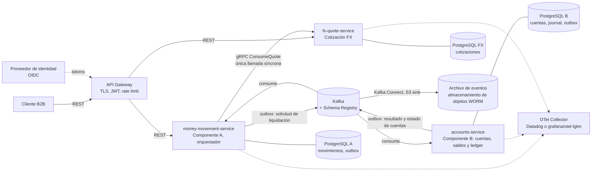
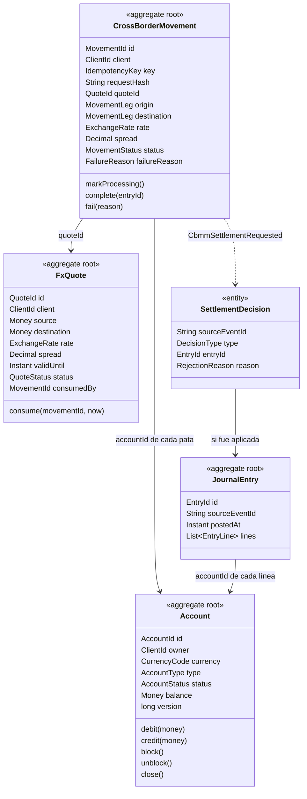
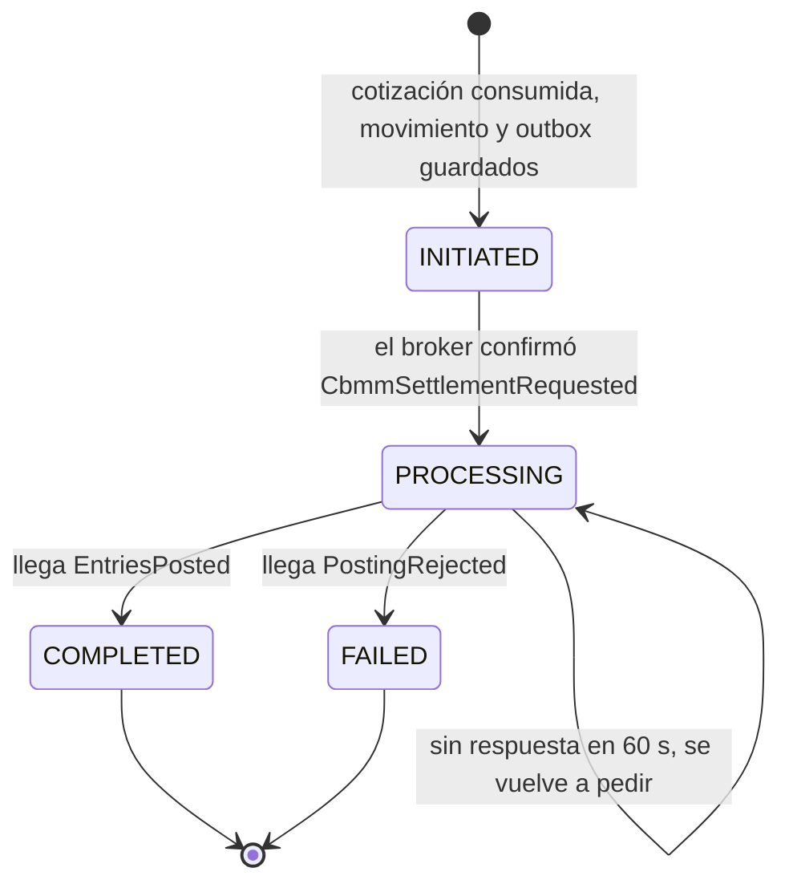
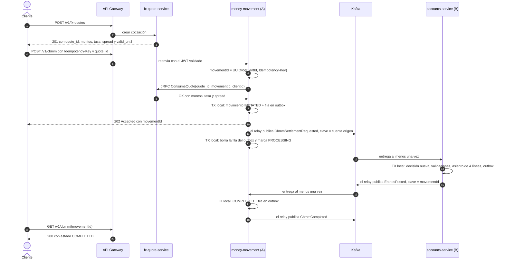

# CBMM · Task 1: diseño del flujo de eventos

2 de noviembre de 2026 · William Pinilla

## 1. Objetivo

Este documento diseña el flujo de eventos completo de un movimiento de dinero transfronterizo (CBMM), con idempotencia y consistencia eventual, y resuelve las seis consideraciones de implementación del caso: Schema Evolution, Versioning, Error Handling and Retry Mechanisms, Monitoring and Observability, Security, y Data Archiving and Retention.

Los valores numéricos (timeouts, intentos, particiones, umbrales de alerta) son los de arranque del sistema y se ajustan con pruebas de carga. Los nombres en código (clases, eventos, tópicos, códigos de error) están en inglés; el resto, en español.

## 2. El caso

Un CBMM es una venta de divisas a Cobre: el cliente entrega una moneda desde una cuenta y recibe otra moneda en otra cuenta, al precio de una cotización previa. Cobre es la contraparte de la operación. Ambas cuentas viven en la plataforma.

| Paso | Qué ocurre | Componente | Interacción |
| --- | --- | --- | --- |
| 1 | El cliente pide una cotización (moneda origen, moneda destino, monto) | fx-quote-service | REST síncrono |
| 2 | El cliente solicita el CBMM referenciando la cotización | money-movement-service (Componente A) | REST síncrono; responde 202 Accepted |
| 3 | A envía el movimiento a liquidar | A → B | Evento `CbmmSettlementRequested` |
| 4 | B valida el saldo de la cuenta origen y registra el asiento | accounts-service (Componente B) | Transacción local en la base de B |
| 5 | B notifica el resultado y A deja el CBMM en estado final | B → A | Evento `EntriesPosted` (COMPLETED) o `PostingRejected` (FAILED) |

### Ejemplo del caso

Evento `cbmm_20250909_000123` del 9 de septiembre de 2025: la cuenta ACC123456789 entrega 15,000.50 MXN y la cuenta ACC987654321 recibe 880.25 USD (tasa implícita: 17.0412 MXN por USD). Saldos esperados, con la convención saldo = créditos − débitos:

| Cuenta | Moneda | Antes | Después |
| --- | --- | --- | --- |
| ACC123456789 | MXN | 200,000.00 | 184,999.50 |
| ACC987654321 | USD | 0.00 | 880.25 |
| COBRE_FX_POSITION_MXN | MXN | 0.00 | 15,000.50 |
| COBRE_FX_POSITION_USD | USD | 0.00 | −880.25 |
| COBRE_FUNDING_MXN | MXN | −200,000.00 | −200,000.00 |

El saldo inicial de 200,000.00 MXN entra como un asiento de apertura contra la cuenta de fondeo de Cobre; por eso esa cuenta es negativa. En cada moneda, la suma de todos los saldos es 0: es el invariante contable del sistema.

### Alcance

| Dentro | Fuera |
| --- | --- |
| CBMM entre dos cuentas de la plataforma | Entrega a bancos externos (payouts) |
| Cotización estática de 25 s y un solo uso | Cotizaciones que se recalculan (rolling) |
| Validación de fondos al liquidar | Reserva de fondos y sobregiros |
| Ledger de partida doble con cuentas de posición de Cobre | Cumplimiento: lavado de dinero, sanciones, KYC |
| Estado final consultable por el cliente | Webhooks al cliente, cancelación y reverso (sección 9) |

## 3. Glosario

| Término | Nombre en código | Significado |
| --- | --- | --- |
| Movimiento (CBMM) | `CrossBorderMovement` | La operación que pide el cliente, con su ciclo de vida |
| Cotización | `FxQuote` | Precio garantizado por 25 s: par de monedas, montos, tasa y spread |
| Spread | `spread` | Margen de Cobre incluido en la tasa; es la única comisión |
| Cuenta | `Account` | Cuenta de la plataforma: titular, moneda, estado y saldo |
| Cuenta de posición de Cobre | `COBRE_FX_POSITION_<moneda>` | Cuenta de Cobre por moneda: recibe la moneda que Cobre compra y paga la que vende; puede quedar negativa |
| Cuenta de fondeo de Cobre | `COBRE_FUNDING_<moneda>` | Contrapartida de los saldos iniciales; puede quedar negativa |
| Asiento contable | `JournalEntry` | Registro inmutable con al menos dos líneas; débitos iguales a créditos en cada moneda |
| Línea de asiento | `EntryLine` | Una cuenta, una dirección (`DEBIT` o `CREDIT`) y un monto |
| Liquidación | `settlement` | Validar un CBMM contra las cuentas y registrar su asiento |
| Clave de idempotencia | `Idempotency-Key` | Identificador que pone el cliente para que repetir la solicitud no cree otro movimiento |
| Outbox | `outbox` | Tabla en la base del productor; el evento se escribe ahí en la misma transacción que el cambio de negocio |
| Relay | `OutboxRelay` | Proceso dentro del mismo servicio que publica las filas del outbox en Kafka |
| Tópico de mensajes muertos | `<tópico>.dlt` | Tópico donde van los mensajes que no se pudieron procesar después de los reintentos |

En el código se evita la palabra "transacción" para el negocio: se usa movimiento para la operación y asiento para el registro contable.

## 4. Decisiones de arquitectura

| # | Decisión | Razón |
| --- | --- | --- |
| D1 | El Componente B es el módulo de cuentas: cuentas, saldos y ledger forman un solo contexto y un solo servicio, `accounts-service` | La regla "no se mueve dinero de una cuenta bloqueada" exige que estado y saldo cambien en la misma transacción (sección 5.3) |
| D2 | Tres contextos de negocio, cada uno con su servicio y su base: Cotización FX, Movimiento de dinero (A) y Cuentas (B). Ningún servicio lee la base de otro | Cada contexto cambia por razones distintas y escala por separado |
| D3 | La cotización vale 25 s y se consume una sola vez. Si el CBMM falla, la cotización no se reutiliza; el cliente pide otra | 25 s es la vigencia que documenta Cobre; un solo uso evita ejecutar dos veces una tasa garantizada |
| D4 | El CBMM termina siempre en una cuenta de la plataforma. Cobre es la contraparte mediante una cuenta de posición por moneda | El CBMM es la conversión; la entrega a un banco externo es otro movimiento |
| D5 | Los fondos se validan al liquidar; no hay reserva | Una sola validación, en el único servicio que conoce los saldos |
| D6 | La comisión es el spread incluido en la tasa; el asiento no tiene línea de comisión | El cliente ve un solo precio |
| D7 | Saga orquestada por A: A conoce el flujo y B solo responde | El estado del CBMM queda en un solo lugar |
| D8 | Una sola llamada síncrona entre servicios: A consume la cotización en FX por gRPC. Todo lo demás viaja por Kafka | La cotización vence en 25 s y el cliente necesita saber de inmediato si se aceptó |
| D9 | Cada productor publica con outbox transaccional y cada consumidor es idempotente | Kafka entrega al menos una vez; así cada efecto ocurre una sola vez |
| D10 | B guarda la decisión de cada solicitud, aplicada o rechazada, por su `event_id`. Ante un duplicado, repite la misma decisión y nunca vuelve a evaluar | Evita mover dinero de un movimiento que ya se informó como fallido (sección 6.5) |
| D11 | El ID del movimiento se deriva de la clave de idempotencia: `movementId = UUIDv5(namespace CBMM, clientId + ":" + Idempotency-Key)` | Si A cae después de consumir la cotización, el reintento del cliente usa el mismo ID y la cotización no se pierde |
| D12 | Un timeout nunca deja un movimiento en FAILED: A vuelve a pedir la liquidación con el mismo `event_id` y, si no hay respuesta, lo marca para conciliación | Un timeout no prueba que el dinero no se movió |
| D13 | Las solicitudes de liquidación se particionan por la cuenta origen; los consumidores reintentan de forma bloqueante, con tope, y después envían a DLT | Mantiene el orden de los débitos de cada cuenta |
| D14 | Circuit breaker solo en llamadas síncronas | En el flujo por eventos, reintentos y DLT cumplen esa función (sección 7.3) |
| D15 | Contratos de eventos en Protobuf, sobre CloudEvents 1.0 en modo binario, registrados en Confluent Schema Registry con compatibilidad `BACKWARD_TRANSITIVE`; `buf breaking` en CI | Un cambio incompatible se rechaza en el build y otra vez al registrarse |
| D16 | El saldo de las cuentas de Cobre (posición y fondeo) se calcula desde el journal; no se actualiza una fila por asiento | Todas las liquidaciones tocan esas cuentas; actualizar su fila serializaría el sistema |
| D17 | El journal es inmutable: sin UPDATE ni DELETE. Una corrección es un asiento compensatorio nuevo | Es el registro contable y la auditoría |
| D18 | Instrumentación con OpenTelemetry. Backend: Datadog en producción; `grafana/otel-lgtm` en la demo | El código no depende del proveedor y la demo corre sin cuenta |
| D19 | JWT (OIDC) en las APIs; mTLS entre servicios; Kafka con SASL_SSL, OAUTHBEARER y ACLs por tópico. Ningún mensaje lleva un JWT | Un token vence en minutos y un evento se puede reprocesar días después (sección 7.5) |
| D20 | Journal, movimientos y archivo de eventos se conservan 10 años. Los mensajes muertos se guardan en una tabla hasta resolverse | Plazo legal contable más largo de los dos países del caso (sección 7.6) |

## 5. Arquitectura

### 5.1 Vista de contenedores



El Gateway autentica y enruta; no contiene reglas de negocio.

### 5.2 Contextos

| Contexto | Servicio | Responsabilidad | Datos propios |
| --- | --- | --- | --- |
| Cotización FX | `fx-quote-service` | Emitir cotizaciones (tasa de mercado más spread) y consumirlas una sola vez | Cotizaciones |
| Movimiento de dinero | `money-movement-service` (A) | Recibir la solicitud, validar contra la cotización, orquestar la saga y fijar el estado final | Movimientos, outbox |
| Cuentas | `accounts-service` (B) | Cuentas, saldos, liquidación y journal | Cuentas, asientos, decisiones, outbox |

### 5.3 Por qué cuentas, saldos y ledger van en un mismo servicio (D1)

La alternativa natural es separar un servicio de Cuentas (titular, moneda, estado) de un servicio de Ledger (saldos y asientos), y que el Ledger reciba el estado de cada cuenta por eventos. Esa separación rompe una regla de negocio:

| Hora | Servicio de Cuentas | Servicio de Ledger |
| --- | --- | --- |
| 10:00:00.000 | Operaciones bloquea ACC123456789 y se publica `AccountBlocked` | Su copia de la cuenta todavía dice ACTIVE |
| 10:00:00.800 | | Llega un CBMM que debita ACC123456789; la copia dice ACTIVE y el débito se aplica |
| 10:00:02.000 | | Llega `AccountBlocked`; la copia se actualiza, demasiado tarde |

Con un solo servicio, el estado y el saldo están en la misma fila de `Account`. El bloqueo y el débito toman el mismo lock de fila: o el débito ocurre antes del bloqueo, o se rechaza con `ACCOUNT_INACTIVE`. La ventana desaparece.

A también necesita datos de las cuentas, para rechazar de inmediato una solicitud mal formada. Usa una copia local alimentada por el tópico `accounts.account-snapshots.v1`, pero solo para dos datos que nunca cambian: el titular y la moneda. El estado y los fondos, que sí cambian, los valida únicamente B. Así, una copia desactualizada en A no puede producir un movimiento incorrecto: en el peor caso, B lo rechaza.

### 5.4 Agregados



| Agregado | Contexto | Invariantes |
| --- | --- | --- |
| `FxQuote` | Cotización FX | Se consume una sola vez. No se consume después de `validUntil`. Consumirla otra vez con el mismo `movementId` responde OK aunque ya haya vencido, porque el consumo original ocurrió a tiempo. Solo la consume el cliente que la pidió |
| `CrossBorderMovement` | Movimiento de dinero | Monedas origen y destino distintas. Montos y monedas iguales a los de la cotización. Copia la tasa y el spread de la cotización. Solo transiciones válidas (sección 5.6). COMPLETED y FAILED no cambian |
| `Account` | Cuentas | Titular y moneda no cambian. Saldo ≥ 0 en cuentas de cliente. No se debita ni se acredita una cuenta BLOCKED o CLOSED. CLOSED es final |
| `JournalEntry` | Cuentas | Al menos dos líneas. Débitos iguales a créditos en cada moneda. Moneda de cada línea igual a la de su cuenta. Inmutable (D17) |
| `SettlementDecision` | Cuentas | Una sola decisión por `sourceEventId` (D10). Tipo `APPLIED` con su asiento, o `REJECTED` con su motivo |

En las cuentas de tipo `COBRE_POSITION` y `COBRE_FUNDING`, `balance` no se guarda en la fila: es el último saldo de cierre mensual más la suma de las líneas posteriores (D16).

El adaptador de entrada de B es una capa anticorrupción: traduce `CbmmSettlementRequested` al comando interno `PostSettlement`. El dominio de Cuentas solo conoce asientos; un pago u otro movimiento futuro usa el mismo comando.

### 5.5 Asiento del ejemplo

| Pata | Débito | Crédito | Monto |
| --- | --- | --- | --- |
| MXN | ACC123456789 | COBRE_FX_POSITION_MXN | 15,000.50 MXN |
| USD | COBRE_FX_POSITION_USD | ACC987654321 | 880.25 USD |

Un solo asiento de cuatro líneas, en una transacción local de B. Si falla cualquier validación, no se escribe ninguna línea.

### 5.6 Ciclo de vida del movimiento



| Estado | Significado | Quién lo fija |
| --- | --- | --- |
| INITIATED | Movimiento creado y cotización consumida; la solicitud de liquidación está en el outbox de A y todavía no llegó al broker | A, al crear el movimiento |
| PROCESSING | El broker confirmó la solicitud; A espera la decisión de B | El relay de A, al recibir la confirmación del broker |
| COMPLETED | B registró el asiento; los saldos cambiaron | A, al consumir `EntriesPosted` |
| FAILED | B rechazó la solicitud; ningún saldo cambió | A, al consumir `PostingRejected` |

Un movimiento que necesita revisión manual conserva su estado y recibe la marca `needs_reconciliation` (sección 6.6).

## 6. Flujo de eventos

### 6.1 Camino feliz



El 202 es la consistencia eventual expresada en el contrato: el cliente sabe que el movimiento existe, no que ya terminó. El estado final se consulta con GET.

Si el servicio A cae entre la confirmación del broker y la transacción que marca PROCESSING, el relay vuelve a publicar la misma fila al reiniciar. B recibe un duplicado con el mismo `event_id` y lo resuelve con D10.

### 6.2 API

| Operación | Entrada | Respuesta |
| --- | --- | --- |
| `POST /v1/fx-quotes` | Moneda origen, moneda destino, monto origen | 201 con `quote_id`, montos origen y destino, tasa, spread y `valid_until` |
| `POST /v1/cbmm` | Header `Idempotency-Key`; cuerpo con `quote_id`, cuenta origen, cuenta destino, monto origen y monto destino | 202 con `movement_id` y estado. Errores en la sección 6.9 |
| `GET /v1/cbmm/{movement_id}` | — | 200 con estado y, si falló, el motivo |
| gRPC `FxQuoteService.ConsumeQuote` | `quote_id`, `movement_id`, `client_id` | Montos, tasa y spread, o `QUOTE_NOT_FOUND`, `QUOTE_EXPIRED` o `QUOTE_ALREADY_CONSUMED` |

Orden de A al recibir `POST /v1/cbmm`:

1. Calcula `movementId` (D11). Si ese movimiento ya existe, compara el hash del cuerpo: si es igual, devuelve el movimiento existente; si es distinto, responde 422 `IDEMPOTENCY_KEY_REUSED`. No llama a FX.
2. Valida con su copia local que el cliente es titular de la cuenta origen y que las monedas de las cuentas coinciden con las de la solicitud.
3. Llama a `ConsumeQuote` y compara montos y monedas con la cotización.
4. Guarda el movimiento en INITIATED y la fila del outbox en una sola transacción. Si dos solicitudes iguales llegan a la vez, la clave primaria deja pasar solo una y la otra devuelve el movimiento ya creado.

### 6.3 Eventos y tópicos

| Tópico | Eventos | Productor | Consumidores | Clave | Particiones |
| --- | --- | --- | --- | --- | --- |
| `cbmm.settlement-requests.v1` | `CbmmSettlementRequested` | A | B | `account_id` de la cuenta origen | 12 |
| `accounts.settlement-results.v1` | `EntriesPosted`, `PostingRejected` | B | A | `movement_id` | 12 |
| `cbmm.movements.v1` | `CbmmCompleted`, `CbmmFailed` | A | Archivo de eventos | `movement_id` | 12 |
| `accounts.account-snapshots.v1` | `AccountSnapshot` (titular, moneda, estado) | B | A | `account_id` | 6, compactado |
| `<tópico>.dlt` | El mensaje original y la causa del fallo | El consumidor que falló | El mismo servicio | La del mensaje original | Las del tópico original |

Cada evento es autocontenido: `CbmmSettlementRequested` lleva las dos patas, los montos, la tasa y el spread, así B no consulta a nadie para liquidar. Microsoft señala como antipatrón diseñar eventos que dependen de eventos pasados o futuros ([Microsoft](https://learn.microsoft.com/en-us/azure/architecture/guide/architecture-styles/microservices)).

`accounts.account-snapshots.v1` es compactado: Kafka conserva el último snapshot de cada cuenta, y A puede reconstruir su copia leyendo el tópico desde el principio.

### 6.4 Idempotencia en cada salto

Kafka, como casi todos los brokers, entrega al menos una vez, y garantizar una entrega exactamente una vez en un sistema distribuido no es práctico. Lo que sí se garantiza es que cada efecto ocurra una vez: el consumidor deduplica por un identificador estable y lo registra en la misma transacción que su efecto de negocio ([Idempotent Consumer, Microsoft](https://learn.microsoft.com/en-us/azure/architecture/patterns/idempotent-consumer)). Las transacciones de Kafka no resuelven este caso: cubren de Kafka a Kafka, y aquí el efecto es una escritura en PostgreSQL.

| # | Salto | Riesgo | Mecanismo |
| --- | --- | --- | --- |
| 1 | Cliente → A | El cliente reintenta tras un timeout | `Idempotency-Key`: la clave y el hash del cuerpo se guardan en el movimiento, con restricción única por cliente y clave. La clave no expira |
| 2 | A → FX | A cae después de consumir la cotización y antes de guardar el movimiento | `movementId` determinístico (D11): el reintento consume con el mismo ID y FX responde OK |
| 3 | A → Kafka | El movimiento se guarda y el evento no sale, o sale dos veces | Outbox: movimiento y fila en la misma transacción. El `event_id` se fija al insertar la fila; cada republicación usa el mismo |
| 4 | Kafka → B | Redelivery, rebalanceo o una nueva solicitud por timeout | Tabla de decisiones con restricción única en `source_event_id`, escrita en la misma transacción que los saldos (D10) |
| 5 | B → Kafka | El resultado se pierde | Outbox en la misma transacción que la decisión. Ante un duplicado, B vuelve a publicar la decisión guardada |
| 6 | Kafka → A | Llega el mismo resultado dos veces | La máquina de estados: solo un movimiento en PROCESSING acepta un resultado; COMPLETED y FAILED no cambian |
| 7 | A → Kafka | `CbmmCompleted` duplicado | Outbox; el `event_id` se deriva de `movementId` y del estado final |

El productor de Kafka tiene `enable.idempotence=true` (valor por defecto) y `acks=all`. Eso evita duplicados por reintentos internos del productor, pero no los que genera el relay al republicar; por eso la deduplicación vive en el consumidor.

### 6.5 Por qué B guarda también los rechazos (D10)

Deduplicar solo por los asientos aplicados deja abierta una falla grave. Ejemplo, con una cuenta que tiene 100.00 MXN:

| Paso | Qué pasa | Resultado si B solo recuerda asientos aplicados |
| --- | --- | --- |
| 1 | Llega la solicitud E1, que debita 150.00 MXN | Fondos insuficientes: B rechaza y publica `PostingRejected` |
| 2 | A recibe el rechazo | El movimiento queda FAILED y el cliente ve que falló |
| 3 | La cuenta recibe un crédito de 100.00 MXN | Ahora tiene 200.00 MXN |
| 4 | E1 llega otra vez: B cayó antes de confirmar el offset en Kafka, o el supervisor de A volvió a pedir la liquidación | E1 no está en el journal, así que B la evalúa de nuevo: ahora hay fondos y debita 150.00 MXN |
| 5 | A recibe `EntriesPosted` para un movimiento FAILED | Lo ignora, porque FAILED no cambia. El dinero salió y el cliente cree que no |

Por eso B guarda una `SettlementDecision` por cada `event_id`, sea `APPLIED` o `REJECTED`. En el paso 4, B encuentra la decisión `REJECTED`, vuelve a publicar el mismo `PostingRejected` y no toca ningún saldo. Una solicitud se evalúa una sola vez en toda su vida.

### 6.6 Saga y consistencia eventual

La saga es orquestada (D7). Con dos participantes, la coreografía no ahorra nada y repartiría el estado del CBMM entre servicios ([Saga, Microsoft](https://learn.microsoft.com/en-us/azure/architecture/patterns/saga)).

| Tipo de transacción de la saga | Paso | Consecuencia |
| --- | --- | --- |
| Compensable | Consumir la cotización y crear el movimiento | Si B rechaza, no hay nada que deshacer: no se movió dinero y la cotización queda consumida a propósito (D3) |
| Pivote | Asiento en B | Punto sin retorno: desde aquí el CBMM solo puede terminar en COMPLETED |
| Reintentable | A marca COMPLETED y publica `CbmmCompleted` | Es idempotente y se reintenta hasta lograrlo |

El supervisor de la saga corre dentro de A cada 30 s (patrón [Scheduler Agent Supervisor](https://learn.microsoft.com/en-us/azure/architecture/patterns/scheduler-agent-supervisor)):

- Un movimiento en PROCESSING por más de 60 s: A vuelve a publicar `CbmmSettlementRequested` con el mismo `event_id`. Si B nunca lo recibió, lo procesa; si ya decidió, vuelve a publicar la decisión (D10).
- Un movimiento en PROCESSING por más de 15 min: recibe la marca `needs_reconciliation` y se dispara una alerta. Su estado no cambia (D12).
- Un movimiento en INITIATED por más de 60 s: el relay no está publicando; se dispara una alerta.
- Conciliación diaria: cada movimiento COMPLETED tiene en B una decisión `APPLIED` con su `event_id`, cada FAILED tiene una `REJECTED`, y no hay decisiones sin movimiento. Cada diferencia abre un incidente.

### 6.7 Orden y concurrencia

Las solicitudes se particionan por la cuenta origen (D13). Las que debitan una misma cuenta se procesan una tras otra; las de cuentas distintas, en paralelo. Es el patrón [Sequential Convoy](https://learn.microsoft.com/en-us/azure/architecture/patterns/sequential-convoy), con la cuenta como clave de categoría.

- Una cuenta destino recibe créditos desde particiones de otras cuentas, así que un crédito y un débito de la misma cuenta pueden procesarse a la vez en particiones distintas. B toma los locks de las cuentas de cliente de cada asiento siempre en orden ascendente de `account_id`, lo que evita deadlocks.
- Las cuentas de Cobre no se bloquean: su saldo se calcula desde el journal (D16).
- Se aplica el orden de llegada a cada partición, no `operation_date`: los fondos se validan en el momento de liquidar (D5).
- Un mensaje que falla siempre bloquearía su partición; por eso los reintentos tienen tope y luego el mensaje va a DLT (sección 7.3).
- La concurrencia de consumidores de B nunca supera las 12 particiones del tópico.

### 6.8 Escenarios de fallo

| Escenario | Detección | Comportamiento | Estado final |
| --- | --- | --- | --- |
| Cotización vencida | `ConsumeQuote` | 422 `QUOTE_EXPIRED`; no se crea movimiento | Sin movimiento |
| Cotización ya consumida por otro movimiento | `ConsumeQuote` | 409 `QUOTE_ALREADY_CONSUMED` | Sin movimiento |
| Montos o monedas distintos a la cotización | A | 422 `AMOUNT_MISMATCH` | Sin movimiento |
| El cliente no es titular de la cuenta origen | A, con su copia local | 403 `ACCOUNT_NOT_OWNED` | Sin movimiento |
| El cliente reintenta el POST | `Idempotency-Key` | Devuelve el mismo movimiento | El del original |
| FX no responde | Reintentos y circuit breaker | 503 `FX_UNAVAILABLE` con `Retry-After`; el cliente reintenta con la misma clave | Sin movimiento o el original |
| Kafka no disponible | Relay de A | El movimiento espera en INITIATED; el relay reintenta | PROCESSING al recuperarse |
| Fondos insuficientes | B | `PostingRejected` con `INSUFFICIENT_FUNDS` | FAILED |
| Cuenta bloqueada o cerrada | B | `PostingRejected` con `ACCOUNT_INACTIVE` | FAILED |
| Base de B caída, deadlock o falla de serialización | B | Reintento bloqueante; la partición espera | El que decida B |
| Mensaje que no se puede leer o con versión mayor desconocida | B | DLT y alerta; el supervisor de A marca el movimiento a los 15 min | PROCESSING con `needs_reconciliation` |
| Resultado perdido o A caído | Supervisor de A | Nueva solicitud con el mismo `event_id`; B repite su decisión | El que decidió B |
| Resultado duplicado | Máquina de estados de A | Se ignora | Sin cambio |

### 6.9 Códigos de error

| Código | Lo detecta | Cómo llega | ¿Se reintenta? |
| --- | --- | --- | --- |
| `QUOTE_NOT_FOUND` | FX | 404 | No |
| `QUOTE_EXPIRED` | FX | 422 | No: el cliente pide otra cotización |
| `QUOTE_ALREADY_CONSUMED` | FX | 409 | No |
| `AMOUNT_MISMATCH` | A | 422 | No |
| `CURRENCY_MISMATCH` | A y B | 422, o `PostingRejected` | No |
| `ACCOUNT_NOT_OWNED` | A | 403 | No |
| `ACCOUNT_NOT_FOUND` | A y B | 404, o `PostingRejected` | No. Una cuenta recién abierta puede tardar en llegar a la copia de A; el cliente reintenta con la misma clave |
| `IDEMPOTENCY_KEY_REUSED` | A | 422 | No |
| `FX_UNAVAILABLE` | A | 503 con `Retry-After` | Sí, el cliente, con la misma clave |
| `INSUFFICIENT_FUNDS` | B | `PostingRejected`; el movimiento queda FAILED | No |
| `ACCOUNT_INACTIVE` | B | `PostingRejected`; el movimiento queda FAILED | No |

## 7. Consideraciones de implementación

### 7.1 Schema Evolution

Evolucionan tres contratos, cada uno con su mecanismo: los eventos, las APIs y el esquema de cada base.

**Formato.** Protobuf para los eventos de Kafka y para gRPC; JSON en la API REST. Los montos viajan como texto decimal (`"15000.50"`), nunca como número de punto flotante.

**Sobre del evento.** Se adopta [CloudEvents 1.0](https://github.com/cloudevents/spec/blob/main/cloudevents/bindings/kafka-protocol-binding.md) en modo binario: los metadatos viajan en headers de Kafka y el cuerpo es el mensaje Protobuf.

| Header | Contenido | Uso |
| --- | --- | --- |
| `ce_id` | `event_id` | Clave de deduplicación |
| `ce_type` | Por ejemplo `com.cobre.cbmm.settlement-requested` | Tipo de evento |
| `ce_source` | Servicio productor | Informativo; la identidad real la garantiza el broker (sección 7.5) |
| `ce_time` | Momento en que se emitió el evento | Trazabilidad |
| `ce_dataschema` | Subject y versión en el Schema Registry | Versión del esquema |
| `ce_correlationid` | `movement_id` | Igual en todos los eventos de un CBMM |
| `ce_causationid` | `event_id` del evento que causó este | Reconstruir la cadena de la saga |
| `traceparent` | Contexto de traza W3C | Trazas distribuidas |

`operation_date`, el momento de negocio de la operación, va en el cuerpo y es distinto de `ce_time`.

```proto
syntax = "proto3";
package cobre.cbmm.events.v1;

import "google/protobuf/timestamp.proto";

message CbmmSettlementRequested {
  string movement_id = 1;
  string client_id = 2;
  Leg origin = 3;
  Leg destination = 4;
  google.protobuf.Timestamp operation_date = 5;
  string quote_id = 6;
  Decimal fx_rate = 7;
  Decimal spread = 8;
}

message Leg {
  string account_id = 1;
  string currency = 2;   // ISO 4217
  Decimal amount = 3;
}

message Decimal {
  string value = 1;      // "15000.50"
}
```

**Registro y compatibilidad (D15).** Confluent Schema Registry, con compatibilidad `BACKWARD_TRANSITIVE`: es la práctica recomendada para Protobuf, porque agregar tipos de mensaje no es compatible hacia adelante. Con este modo, primero se despliegan los consumidores y después los productores ([Confluent](https://docs.confluent.io/platform/current/schema-registry/fundamentals/schema-evolution.html)). Como el tópico de resultados lleva dos tipos de evento, los subjects usan `TopicRecordNameStrategy`.

- `buf breaking` corre en CI contra la rama principal y rompe el build ante un cambio incompatible. El registry vuelve a validar al registrar el esquema.
- Los servicios tienen `auto.register.schemas=false`: solo el pipeline registra esquemas.
- Reglas Protobuf: un número de campo nunca se reutiliza ni se cambia; un campo eliminado pasa a `reserved`; cada enum empieza con `*_UNSPECIFIED = 0`; todo campo nuevo tiene un valor por defecto seguro.
- Lector tolerante: los consumidores ignoran los campos que no conocen. La capa anticorrupción de B convierte cada versión soportada al mismo comando interno; el dominio no ve versiones.

Ejemplo de evolución:

| Cambio | Tipo | Qué se hace |
| --- | --- | --- |
| Agregar el campo opcional `purpose_code = 9` | Compatible | Mismo tópico. Se registra la nueva versión, se despliega B y después A |
| Cambiar la representación de `amount` | Incompatible | Paquete `cobre.cbmm.events.v2` y tópico `cbmm.settlement-requests.v2` (sección 7.2) |

**Bases de datos.** Flyway en cada servicio, sobre su propia base. Una migración aplicada no se edita. Los cambios siguen expand/contract: primero se agrega la columna o tabla nueva; luego se despliega el código que escribe en ambas; se migran los datos; al final se retira lo viejo. Así la versión nueva y la anterior del servicio conviven durante un despliegue gradual.

### 7.2 Versioning

| Artefacto | Cambio compatible | Cambio incompatible |
| --- | --- | --- |
| Esquema de evento | Nueva versión en el mismo tópico; el registry la valida | Tópico nuevo con sufijo de versión mayor (`.v2`). El productor publica en ambos tópicos durante la migración, y `.v1` se retira cuando ningún consumidor lo lee y su DLT está vacío |
| Consumidor | Lector tolerante en el mismo consumer group | Consumer group nuevo por versión mayor (`accounts-service.settlement.v2`), que corre en paralelo al anterior. Un mensaje con versión mayor desconocida va a DLT; nunca se descarta en silencio |
| API REST | Campos nuevos en la respuesta; el servicio acepta solicitudes sin ellos | Versión mayor en la ruta (`/v2/cbmm`), servida junto a la anterior; la anterior se anuncia con los headers `Deprecation` y `Sunset` |
| gRPC | Campos nuevos en el mismo paquete | Paquete nuevo (`cobre.fxquote.v2`), servido junto al anterior |
| Servicio | Versión semántica; despliegue gradual con la versión anterior aún activa | Igual, más el plan de migración del contrato afectado |

Los clientes eligen solo la versión mayor de una API, y una versión vieja se retira lo antes posible porque cada versión activa cuesta pruebas y operación ([API design, Microsoft](https://learn.microsoft.com/en-us/azure/architecture/microservices/design/api-design)). Los contratos de eventos se prueban en CI con tests de contrato por consumidor.

### 7.3 Error Handling and Retry Mechanisms

Antes de elegir un patrón hay que clasificar el error. Reintentar un rechazo de negocio es un bug, y dar por fallido un timeout también.

| Clase | Ejemplos | Tratamiento |
| --- | --- | --- |
| Transitorio técnico | Timeout, `UNAVAILABLE` de gRPC, broker no disponible, deadlock (`40P01`) o falla de serialización (`40001`) en PostgreSQL | Reintento con backoff exponencial y jitter |
| Permanente técnico | Mensaje que no se puede leer, versión mayor desconocida, datos que violan el contrato | Sin reintento: DLT y alerta |
| Rechazo de negocio | Los códigos de la sección 6.9 | Es un resultado: se responde o se publica, nunca se reintenta |
| Ambiguo | Un paso con efectos que no respondió | No se asume que falló: nueva solicitud idempotente o conciliación (D12) |

| Patrón | Dónde | Configuración |
| --- | --- | --- |
| [Retry](https://learn.microsoft.com/en-us/azure/architecture/patterns/retry) | gRPC de A a FX | 3 intentos, espera inicial de 100 ms que se duplica, con jitter; límite total de 2 s, muy por debajo de los 25 s de la cotización. Es seguro porque `ConsumeQuote` es idempotente |
| Retry | Relay del outbox | Espera exponencial hasta 30 s, sin límite de intentos: el outbox es una cola durable |
| Retry bloqueante | Consumidores de Kafka | Espera exponencial de 1 s a 30 s, durante 5 min como máximo; después, DLT. Es bloqueante a propósito: los reintentos no bloqueantes de Spring Kafka, con tópicos de reintento, pierden el orden del tópico ([Spring](https://docs.enterprise.spring.io/spring-kafka/reference/retrytopic/how-the-pattern-works.html)) |
| [Circuit Breaker](https://learn.microsoft.com/en-us/azure/architecture/patterns/circuit-breaker) | gRPC de A a FX, y de FX al proveedor de tasas | Resilience4j: se abre con 50 % de fallas en las últimas 20 llamadas, queda abierto 10 s y deja pasar 3 llamadas de prueba. Con el circuito abierto, A deja de reintentar y responde 503 |
| Pausa del consumidor | Consumidores de Kafka cuando su base no responde | El listener se pausa y se reanuda cuando la base vuelve; así no se envían a DLT mensajes que no tienen nada malo |
| [Bulkhead](https://learn.microsoft.com/en-us/azure/architecture/patterns/bulkhead) | Todos los servicios | Pool de conexiones propio por servicio, ejecutor separado para las llamadas gRPC, concurrencia de consumidores limitada por las particiones |
| Tópico de mensajes muertos | Cada tópico | Headers con la excepción, el offset original y los intentos. Un consumidor del mismo servicio guarda cada mensaje en la tabla `dead_letter` (estado `OPEN`). Un operador lo corrige y lo republica al tópico original (`RESOLVED`), algo seguro gracias a la idempotencia, o lo descarta con justificación (`DISCARDED`) |
| Supervisor de la saga | A | Sección 6.6 |

¿Por qué no hay circuit breaker en el flujo por eventos? Microsoft no lo recomienda en arquitecturas orientadas a mensajes o eventos: allí los mensajes fallidos van a una cola de mensajes muertos, y el aislamiento y los reintentos propios del broker suelen bastar ([Circuit Breaker, Microsoft](https://learn.microsoft.com/en-us/azure/architecture/patterns/circuit-breaker)). El breaker se usa donde puede haber fallas en cascada hacia el cliente: en las llamadas síncronas.

Los intentos intermedios se registran como información y solo el último fallo como error ([Retry, Microsoft](https://learn.microsoft.com/en-us/azure/architecture/patterns/retry)).

### 7.4 Monitoring and Observability

Todos los servicios se instrumentan con OpenTelemetry, que Microsoft recomienda para la trazabilidad distribuida en microservicios ([Microsoft](https://learn.microsoft.com/en-us/azure/architecture/guide/architecture-styles/microservices)). Un OTel Collector recibe logs, trazas y métricas y los envía al backend de cada ambiente (D18):

| Ambiente | Backend | Razón |
| --- | --- | --- |
| Producción | Datadog, vía el OTel Collector con el exporter de Datadog | Datadog recibe OpenTelemetry de forma nativa ([Datadog](https://docs.datadoghq.com/opentelemetry/setup/)); cambiar de proveedor solo cambia la configuración del Collector |
| Demo (Docker Compose) | Imagen `grafana/otel-lgtm`: Grafana, Loki, Tempo y Prometheus en un contenedor | Corre sin cuenta ni API key |

**Logs.** JSON estructurado con `trace_id`, `span_id`, `correlation_id` (`movement_id`), `event_id`, servicio y versión. Los IDs de cuenta se enmascaran (`ACC****6789`) y nunca se registran tokens.

**Trazas.** El header `traceparent` viaja en cada mensaje de Kafka. La fila del outbox guarda el `traceparent` de la transacción que la creó, y el relay lo usa al publicar; sin eso, la traza se cortaría justo en el salto asíncrono. Del POST al COMPLETED se ve una sola traza. El Collector conserva el 100 % de las trazas con error y el 10 % del resto.

**Métricas.**

| Tipo | Métricas |
| --- | --- |
| Negocio | CBMM por estado final; tiempo hasta el estado final (p50, p95, p99); rechazos por código; movimientos con `needs_reconciliation` |
| Flujo | Lag por consumer group y partición; filas pendientes del outbox y antigüedad de la más vieja; mensajes `OPEN` en `dead_letter`; reintentos |
| Resiliencia | Estado del circuit breaker; latencia y errores de gRPC |
| Recursos | Uso del pool de conexiones, memoria y CPU de la JVM |
| Invariante | Suma de saldos por moneda, incluidas las cuentas de Cobre; debe ser 0 |

`account_id` y `movement_id` nunca son etiquetas de una métrica: con una etiqueta por cuenta, el número de series crece sin límite y, en Datadog, el costo también. Ese detalle se busca en logs y trazas.

**Objetivo de servicio y alertas.** El 99 % de los CBMM llega a estado final en menos de 5 s. Alertas:

| Alerta | Condición |
| --- | --- |
| Invariante roto | Suma por moneda distinta de 0. Es la única que despierta a alguien de inmediato |
| Movimiento en conciliación | Cualquier movimiento con `needs_reconciliation` |
| Mensaje muerto | Cualquier mensaje `OPEN` en `dead_letter` |
| Outbox detenido | Fila pendiente con más de 60 s |
| Consumidor atrasado | Lag mayor a 1,000 mensajes durante 5 min |
| Dependencia caída | Circuit breaker abierto |

**Salud.** Cada servicio expone liveness y readiness; readiness incluye la base y el broker ([Health Endpoint Monitoring, Microsoft](https://learn.microsoft.com/en-us/azure/architecture/patterns/health-endpoint-monitoring)).

La observabilidad no es la auditoría: los logs se borran. La auditoría es el journal inmutable más el archivo de eventos.

### 7.5 Security

El caso pide dos cosas: canales seguros, y autenticación y autorización de productores y consumidores de eventos.

| Capa | Autenticación | Autorización |
| --- | --- | --- |
| Cliente → Gateway | OAuth2/OIDC. El Gateway valida el JWT (firma, `iss`, `aud`, expiración) sobre TLS 1.3 | Scopes `cbmm:write` y `cbmm:read`; límite de solicitudes por cliente |
| Gateway → servicios y A → FX | mTLS entre servicios. Cada servicio vuelve a validar el JWT como resource server. A obtiene su token para FX con client credentials (`aud` = FX) | Scopes por operación |
| Productores y consumidores de Kafka | SASL_SSL con OAUTHBEARER: cada servicio obtiene un token del proveedor de identidad con client credentials y lo presenta al conectarse ([KIP-768](https://cwiki.apache.org/confluence/spaces/KAFKA/pages/186877575/KIP-768+Extend+SASL+OAUTHBEARER+with+Support+for+OIDC)). Una identidad por servicio | ACLs por identidad (tabla siguiente) |
| Schema Registry | TLS y credenciales por servicio | Solo el pipeline de CI escribe; los servicios solo leen |
| Reglas de negocio | El `client_id` sale del token | A verifica que el cliente es titular de la cuenta origen; B verifica estado y moneda de las cuentas |

| Identidad | Escribe en | Lee de |
| --- | --- | --- |
| `money-movement-service` | `cbmm.settlement-requests.v1`, `cbmm.movements.v1` | `accounts.settlement-results.v1`, `accounts.account-snapshots.v1` |
| `accounts-service` | `accounts.settlement-results.v1`, `accounts.account-snapshots.v1` | `cbmm.settlement-requests.v1` |
| Conector del archivo | — | `cbmm.*`, `accounts.*` |

Cada identidad tiene, además, su propio consumer group y sus DLT.

Decisiones y su razón:

- **El JWT autentica la conexión, no cada mensaje (D19).** Un token vence en minutos, y un evento se reintenta o se reprocesa desde una DLT días después, cuando su token ya no se puede validar. La identidad del productor la garantiza el broker: si solo A puede escribir en `cbmm.settlement-requests.v1`, todo lo que hay ahí lo escribió A. Por eso `ce_source` es solo informativo: lo declara el propio productor.
- **El JWT se valida en el Gateway y en cada servicio.** Microsoft recomienda centralizar la autenticación en el Gateway, a condición de que ningún servicio sea alcanzable sin pasar por él o que tenga su propia seguridad ([Microsoft](https://learn.microsoft.com/en-us/dotnet/architecture/microservices/secure-net-microservices-web-applications/)). También considera antipatrón meter la validación de tokens dentro de cada servicio, porque complica su código. Aquí se acepta ese costo porque la validación es configuración del framework (Spring Security como resource server), no código propio, y porque un servicio que mueve dinero no debe quedar abierto si alguien llega a él sin pasar por el Gateway.
- **La configuración de seguridad es compartida; las reglas de negocio no.** Un starter de plataforma común trae la configuración de resource server, del cliente OAUTHBEARER de Kafka y de mTLS. No contiene reglas de autorización de negocio: compartir librerías con lógica entre servicios los acopla, y Microsoft lo señala como antipatrón ([Microsoft](https://learn.microsoft.com/en-us/azure/architecture/guide/architecture-styles/microservices)). La titularidad de una cuenta es una regla del dominio de A.
- **Datos.** Cifrado en reposo en las bases, los volúmenes del broker y el archivo. Los secretos no viven en el código ni en las imágenes: en producción, en el gestor de secretos de la nube, con llaves en su KMS; en la demo, en variables de entorno de Docker Compose. El usuario de base de la aplicación B no tiene permiso de UPDATE ni DELETE sobre el journal (D17). Los eventos llevan IDs, nunca nombres ni otros datos personales.
- **Proveedor de identidad.** En producción, el proveedor OIDC de la organización; en la demo, Keycloak en Docker Compose.

### 7.6 Data Archiving and Retention

El marco viene de *Fundamentals of Data Engineering* (Reis y Housley, cap. 6). La retención de cada dato se decide con cuatro preguntas: valor (¿se puede recrear?), tiempo (¿cuánto tiempo necesita acceso rápido?), cumplimiento (¿qué ley obliga a conservarlo o a borrarlo?) y costo. Los datos pasan de caliente (acceso frecuente) a tibio (ocasional) y a frío (casi nunca: cumplimiento y recuperación), y el almacenamiento de objetos los mueve de nivel solo con políticas de ciclo de vida. El libro trata este ciclo como parte de la gestión de datos: decidir qué se archiva y cuándo se destruye.

**Plazo legal.** En Colombia, los libros y papeles del comerciante se conservan 10 años desde el último asiento, en papel o en cualquier medio técnico que garantice su reproducción exacta (Ley 962 de 2005, art. 28). En México, la contabilidad se conserva 5 años (Código Fiscal de la Federación, art. 30). El diseño usa el mayor: 10 años (D20). Si el área legal de Cobre fija otro plazo, solo cambia la configuración de las políticas de ciclo de vida.

**Archivo.** Almacenamiento de objetos compatible con S3, con Object Lock en modo compliance: durante el plazo de retención, nadie puede modificar ni borrar un objeto, ni siquiera un administrador. Kafka Connect, con el conector S3 sink, copia todos los tópicos de negocio al archivo en Parquet, particionado por tópico y día.

| Dato | Valor | Caliente | Frío | Borrado |
| --- | --- | --- | --- | --- |
| Journal (asientos y decisiones) | Fuente de verdad contable; no se puede recrear | PostgreSQL, particionado por mes; 24 meses en línea | Al cumplir 24 meses, la partición se exporta a Parquet en el archivo, se verifica contra sus totales y se retira de PostgreSQL | 10 años después del cierre del mes |
| Saldos de cierre mensuales | Permiten calcular saldos sin leer todo el journal | PostgreSQL, sin límite (una fila por cuenta y mes) | — | Con la cuenta, después de 10 años |
| Movimientos CBMM | Soporte de la operación y del precio pactado: copian montos, tasa y spread de la cotización | PostgreSQL, particionado por mes; 24 meses en línea | Igual que el journal | 10 años |
| Tópicos de negocio | Transporte, no fuente de verdad | Kafka, 7 días | Archivo de eventos | 10 años |
| Snapshots de cuentas | Se recrean desde B | Kafka compactado: último estado por cuenta | — | Al cerrar la cuenta (tombstone) |
| Mensajes muertos | Instrucciones de dinero sin resolver | Tópico `.dlt`, 30 días, y tabla `dead_letter` hasta resolverse | Archivo, con su resolución | 10 años |
| Outbox | Técnico | Se borra al confirmar la publicación | — | Inmediato |
| Claves de idempotencia | Evitan duplicados del cliente | Viven en la fila del movimiento | Con el movimiento | Con el movimiento |
| Cotizaciones | El movimiento ya copia el precio pactado | PostgreSQL | — | A los 30 días, consumidas o no |
| Logs | Operación | 30 días | — | 30 días |
| Trazas | Operación | 15 días | — | 15 días |
| Métricas | Tendencias | 13 meses | — | 13 meses |

Reglas que acompañan la tabla:

- El journal es append-only y el archivo es WORM: ni la aplicación ni un operador pueden reescribir la historia.
- Conservar y borrar pueden chocar: la ley de datos personales de Colombia (Ley 1581 de 2012) puede obligar a suprimir los datos de un titular, y la ley contable obliga a conservar los asientos. Se resuelve dejando los datos personales fuera del journal y de los eventos: ahí solo hay IDs. Los datos del titular viven en un maestro de clientes que se puede anonimizar sin tocar la contabilidad.
- Cada trimestre se restaura una muestra del archivo y se compara con sus totales: un archivo que nunca se restauró no está probado.

## 8. Relación con el Task 2

El Task 2 implementa el Componente B, el módulo de cuentas, con arquitectura hexagonal y Spring Boot, y procesa archivos de eventos en lugar de leer de Kafka. La arquitectura hexagonal permite que el mismo dominio sirva a los dos casos: el lector de archivos del Task 2 y el consumidor de Kafka de este diseño son adaptadores de entrada que llaman al mismo caso de uso, `PostSettlement`.

| Elemento del diseño | Cómo aparece en el Task 2 | Estado |
| --- | --- | --- |
| Cuentas, saldos y ledger en un contexto (D1) | Agregados `Account`, `JournalEntry` y `SettlementDecision` | Se implementa |
| Capa anticorrupción | El lector de archivos traduce el evento del caso (`cross_border_money_movement`) al comando `PostSettlement` | Se implementa |
| Lector tolerante | El evento del caso no trae headers CloudEvents ni `quote_id`, y trae el monto como número JSON. El lector lo trata como versión 1 y lee el monto como `BigDecimal` desde el texto, sin pasar por punto flotante | Se implementa |
| Decisiones guardadas (D10) | Si un `event_id` aparece otra vez, en el mismo archivo o en otro, se conserva la primera decisión, también cuando fue un rechazo | Se implementa |
| Orden | En archivos, el orden es global por `operation_date`, con `event_id` como desempate, para que cada ejecución dé el mismo resultado. En Kafka, el orden es el de llegada a cada partición. El dominio no depende del orden: cada adaptador fija su política | Se implementa la política de archivos |
| Concurrencia por cuenta | Se procesan en paralelo solo eventos sin cuentas de cliente en común; los locks se toman en orden de `account_id` | Se implementa |
| Clasificación de errores | Los rechazos de negocio quedan en el reporte con su código; un archivo ilegible o un evento inválido se reporta y el resto sigue; un deadlock o una falla de serialización se reintenta | Se implementa |
| Journal inmutable (D17) y Flyway | Migraciones Flyway; el usuario de base no tiene UPDATE ni DELETE sobre el journal | Se implementa |
| Invariante: suma por moneda igual a 0 | Test automatizado al final de cada procesamiento | Se implementa |
| Observabilidad | Métricas con Micrometer (eventos aplicados y rechazados por código, eventos por segundo) y logs JSON con `event_id` | Se implementa |
| Outbox y eventos de resultado | `EntriesPosted` y `PostingRejected` se emiten por un puerto de salida; su adaptador los escribe en el log, porque no hay broker | Se implementa con adaptador de log |
| Schema Registry, `buf breaking`, CloudEvents | La entrada son archivos JSON | Solo diseño |
| Circuit breaker | El módulo no hace llamadas remotas síncronas | Solo diseño |
| Seguridad de productores y consumidores | Los archivos no tienen productor que autenticar | Solo diseño |
| Retención y archivo | El módulo no corre en un ambiente con archivo | Solo diseño |

## 9. Fuera de alcance

Estas capacidades no forman parte de esta versión. El diseño no las impide, y estas son las reglas que tendrían que respetar:

- **Cancelación.** Solo mientras el movimiento está en INITIATED, es decir, mientras la solicitud no salió del outbox: en una transacción se borra la fila del outbox y el movimiento pasa a CANCELLED. Desde PROCESSING no se puede cancelar.
- **Reverso de un CBMM completado.** Es un movimiento nuevo con su propio asiento compensatorio; el journal no se edita (D17). La regla de precio del reverso la define producto.
- **Entrega a un banco externo y webhooks al cliente.** Son consumidores nuevos de `cbmm.movements.v1`; no cambian el flujo.

## Fuentes

- Caso Sr Software Engineer: Cross Border Money Movements (CBMM), Cobre
- [Crear Cotizaciones FX, Cobre](https://docs.cobre.com/es/crear-cotizaciones-fx-1952119m0)
- [Microservices architecture style, Microsoft](https://learn.microsoft.com/en-us/azure/architecture/guide/architecture-styles/microservices)
- [Interservice communication, Microsoft](https://learn.microsoft.com/en-us/azure/architecture/microservices/design/interservice-communication)
- [API design, Microsoft](https://learn.microsoft.com/en-us/azure/architecture/microservices/design/api-design)
- [Idempotent Consumer pattern, Microsoft](https://learn.microsoft.com/en-us/azure/architecture/patterns/idempotent-consumer)
- [Saga pattern, Microsoft](https://learn.microsoft.com/en-us/azure/architecture/patterns/saga)
- [Sequential Convoy pattern, Microsoft](https://learn.microsoft.com/en-us/azure/architecture/patterns/sequential-convoy)
- [Scheduler Agent Supervisor pattern, Microsoft](https://learn.microsoft.com/en-us/azure/architecture/patterns/scheduler-agent-supervisor)
- [Retry pattern, Microsoft](https://learn.microsoft.com/en-us/azure/architecture/patterns/retry)
- [Circuit Breaker pattern, Microsoft](https://learn.microsoft.com/en-us/azure/architecture/patterns/circuit-breaker)
- [Bulkhead pattern, Microsoft](https://learn.microsoft.com/en-us/azure/architecture/patterns/bulkhead)
- [Health Endpoint Monitoring pattern, Microsoft](https://learn.microsoft.com/en-us/azure/architecture/patterns/health-endpoint-monitoring)
- [Securing .NET microservices and web applications, Microsoft](https://learn.microsoft.com/en-us/dotnet/architecture/microservices/secure-net-microservices-web-applications/)
- [Uso de DDD táctico para diseñar microservicios, Microsoft](https://learn.microsoft.com/es-mx/azure/architecture/microservices/model/tactical-domain-driven-design)
- Joe Reis y Matt Housley, *Fundamentals of Data Engineering*, O'Reilly, 2022, cap. 2 y cap. 6; [resumen del cap. 6](https://technicalsummaries.com/docs/books/fundamentals-of-data-engineering/fode_06/)
- [Schema Evolution and Compatibility, Confluent](https://docs.confluent.io/platform/current/schema-registry/fundamentals/schema-evolution.html)
- [CloudEvents: Kafka protocol binding](https://github.com/cloudevents/spec/blob/main/cloudevents/bindings/kafka-protocol-binding.md)
- [Non-blocking retries, Spring for Apache Kafka](https://docs.enterprise.spring.io/spring-kafka/reference/retrytopic/how-the-pattern-works.html)
- [KIP-768: SASL/OAUTHBEARER con OIDC, Apache Kafka](https://cwiki.apache.org/confluence/spaces/KAFKA/pages/186877575/KIP-768+Extend+SASL+OAUTHBEARER+with+Support+for+OIDC)
- [Send OpenTelemetry data to Datadog](https://docs.datadoghq.com/opentelemetry/setup/)
- [Conservación de la contabilidad, INCP](https://incp.org.co/wp-content/uploads/2025/07/Conservacion-de-la-contabilidad.pdf) (Ley 962 de 2005, art. 28)
- [Código Fiscal de la Federación, art. 30](https://mley.mx/CFF/articulo/30/)
