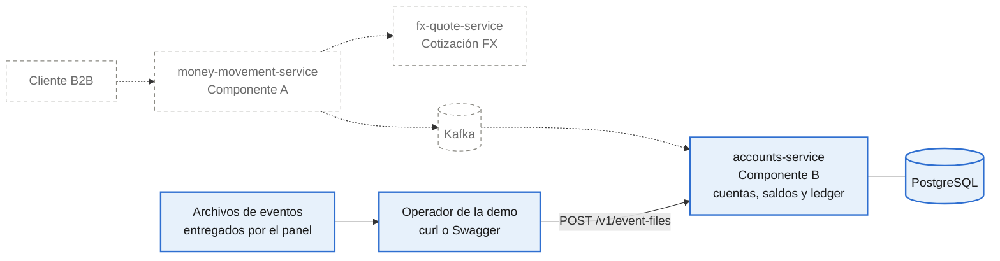
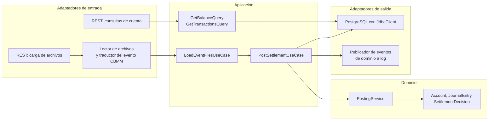
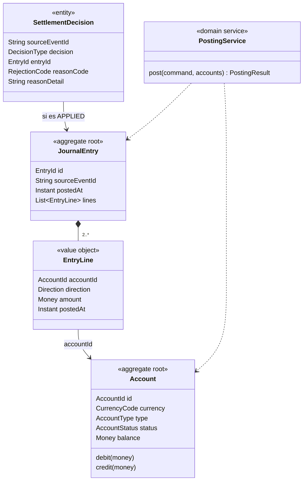
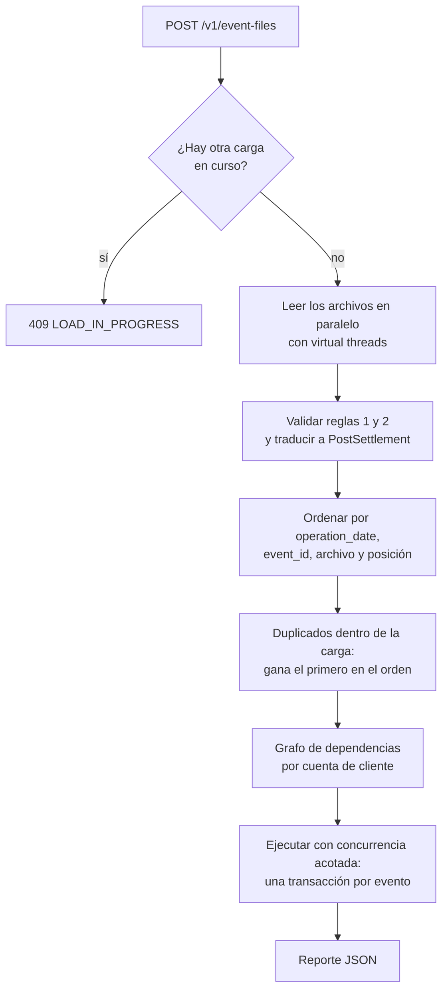

# CBMM · Task 2: especificación del módulo de cuentas

3 de noviembre de 2026 · William Pinilla

## 1. Objetivo y alcance

Este documento especifica lo necesario para implementar el Task 2 del caso: el módulo de cuentas, con Spring Boot y arquitectura hexagonal. El módulo mantiene el saldo de cada cuenta y un ledger auditable de débitos y créditos, procesando de forma concurrente archivos de eventos de movimientos de dinero transfronterizos (CBMM).

**Del sistema CBMM completo solo se implementa el Componente B (`accounts-service`), y su única entrada son archivos de eventos cargados por un endpoint REST.** El Componente A, la cotización FX, Kafka y el resto de la plataforma forman parte del diseño del Task 1 y no se implementan aquí.

Este documento es también la especificación con la que un agente de IA implementa y verifica el módulo: la sección 12 fija sus reglas de trabajo. Ninguna tarea se da por terminada si falla un criterio de aceptación de la sección 10.

## 2. Contexto de negocio

Un CBMM es una venta de divisas a Cobre: el cliente entrega una moneda desde una cuenta y recibe otra moneda en otra cuenta. Cobre es la contraparte. Para el módulo de cuentas, cada CBMM es un débito en la cuenta origen y un crédito en la cuenta destino, en monedas distintas, que se aplican juntos o no se aplican.

### Ejemplo del caso

Evento `cbmm_20250909_000123`: ACC123456789 entrega 15,000.50 MXN y ACC987654321 recibe 880.25 USD. Saldos, con la convención saldo = créditos − débitos:

| Cuenta | Moneda | Antes | Después |
| --- | --- | --- | --- |
| ACC123456789 | MXN | 200,000.00 | 184,999.50 |
| ACC987654321 | USD | 0.00 | 880.25 |
| COBRE_FX_POSITION_MXN | MXN | 0.00 | 15,000.50 |
| COBRE_FX_POSITION_USD | USD | 0.00 | −880.25 |
| COBRE_FUNDING_MXN | MXN | −200,000.00 | −200,000.00 |
| COBRE_FUNDING_USD | USD | 0.00 | 0.00 |

En cada moneda, la suma de todos los saldos es 0. Es el invariante contable del módulo.

## 3. Arquitectura y bounded context

### 3.1 Dónde está el Componente B



En azul, lo que se implementa. Con borde punteado, lo que es solo diseño. En el sistema completo, B recibe las solicitudes de liquidación por Kafka; en el Task 2 las recibe en archivos. El dominio y los casos de uso son los mismos: solo cambia el adaptador de entrada.

### 3.2 Bounded contexts del sistema

| Contexto | Servicio | Responsabilidad | En el Task 2 |
| --- | --- | --- | --- |
| Cotización FX | `fx-quote-service` | Emitir y consumir cotizaciones | No se implementa |
| Movimiento de dinero | `money-movement-service` (Componente A) | Ciclo de vida del CBMM y orquestación | No se implementa |
| Cuentas | `accounts-service` (Componente B) | Cuentas, saldos, liquidación y journal | Se implementa |

Cuentas, saldos y ledger forman un solo contexto porque la regla "no se mueve dinero de una cuenta bloqueada" exige que el estado y el saldo de la cuenta cambien en la misma transacción. Dentro del servicio, la administración de cuentas y la liquidación son módulos separados, con sus propios puertos.

### 3.3 Vista hexagonal



Las dependencias apuntan hacia adentro: adaptadores → aplicación → dominio. El dominio no depende de Spring, de JDBC ni de ningún adaptador.

### 3.4 Modelo de dominio



| Elemento | Invariantes |
| --- | --- |
| `Money` | Inmutable; `BigDecimal` con escala 2; sumar o comparar dos monedas distintas lanza una excepción |
| `Account` | Moneda y tipo no cambian. En `CLIENT`, el saldo nunca es negativo. Solo se debita o acredita una cuenta `ACTIVE`. `CLOSED` es final. En las cuentas de Cobre, `balance` no se guarda: se calcula (D10) |
| `JournalEntry` | Al menos dos líneas; débitos iguales a créditos en cada moneda; montos mayores que 0; moneda de cada línea igual a la de su cuenta; inmutable |
| `SettlementDecision` | Una por `sourceEventId`. `APPLIED` tiene `entryId`; `REJECTED` tiene `reasonCode`. Inmutable |
| `PostingService` | Aplica las reglas 3 a 6 de la sección 7.2 en ese orden y devuelve el asiento con los cambios de saldo, o el rechazo. No accede a la base |

## 4. Glosario

Los nombres en código son obligatorios en clases, tablas, eventos, métricas y tests.

| Término | Nombre en código | Significado |
| --- | --- | --- |
| Cuenta | `Account` | Cuenta de la plataforma: moneda, tipo, estado y saldo |
| Cuenta de cliente | `AccountType.CLIENT` | Cuenta de un cliente; su saldo nunca es negativo |
| Cuenta de posición de Cobre | `AccountType.COBRE_POSITION`, id `COBRE_FX_POSITION_<moneda>` | Recibe la moneda que Cobre compra y paga la que vende; puede quedar negativa |
| Cuenta de fondeo de Cobre | `AccountType.COBRE_FUNDING`, id `COBRE_FUNDING_<moneda>` | Contrapartida de los saldos iniciales; puede quedar negativa |
| Asiento contable | `JournalEntry` | Registro inmutable de un evento aplicado; al menos dos líneas; débitos iguales a créditos en cada moneda |
| Línea de asiento | `EntryLine` | Una cuenta, una dirección (`DEBIT` o `CREDIT`), un monto y su fecha |
| Decisión de liquidación | `SettlementDecision` | Resultado de evaluar un `event_id`: `APPLIED` o `REJECTED` |
| Evento CBMM | `cross_border_money_movement` | Una línea de entrada en un archivo |
| Carga | `Load` | Una llamada al endpoint de carga, con uno o varios archivos |
| Dinero | `Money` | Monto `BigDecimal` con su moneda; operar dos monedas distintas lanza una excepción |

El enunciado llama "transacciones" a lo que el módulo registra. En el código se usa línea de asiento; el endpoint `/transactions` conserva el término del enunciado y cada elemento que devuelve es una línea de asiento.

## 5. Decisiones

| # | Decisión | Razón |
| --- | --- | --- |
| D1 | Solo se implementa el Componente B: cuentas, saldos y ledger en un solo servicio | Es el módulo que pide el Task 2 (sección 3.2) |
| D2 | Los archivos entran por `POST /v1/event-files`, multipart, con uno o varios archivos por carga | El panel entrega los archivos en vivo; no hace falta reiniciar el servicio |
| D3 | Cada carga responde con un reporte JSON; el estado acumulado se consulta con `GET /v1/accounts/{id}/balance` y `/transactions` | El reporte muestra la carga; las consultas, el estado |
| D4 | Dentro de una carga, el orden de aplicación es global por `operation_date`, luego `event_id`, luego nombre de archivo y luego posición en el archivo. Las cargas se aplican en orden de llegada, una a la vez | El resultado de una carga no depende del orden de los archivos ni de la cantidad de hilos |
| D5 | Concurrencia determinística: dos eventos corren en paralelo solo si no comparten cuentas de cliente; los que comparten respetan el orden de D4 | El resultado concurrente es idéntico al secuencial (sección 7.4) |
| D6 | Cada `event_id` se decide una sola vez en la vida del módulo, aplicado o rechazado. Si vuelve a aparecer, en la misma carga o en otra, se reporta como duplicado y conserva la decisión original | Un evento rechazado por fondos no puede aplicarse después porque llegaron fondos (sección 7.5) |
| D7 | Una cuenta que no está en la semilla se rechaza con `ACCOUNT_NOT_FOUND`. Con `cbmm.accounts.auto-create=true` (por defecto `false`) se crea con saldo 0 y la moneda del evento | Nunca aparece dinero de la nada, y la demo se adapta a archivos con cuentas nuevas sin tocar código |
| D8 | Un evento rechazado no detiene la carga; un archivo ilegible se reporta y los demás se procesan | Un error de datos no bloquea el resto |
| D9 | Los saldos iniciales se cargan como asientos de apertura contra `COBRE_FUNDING_<moneda>` | Todo saldo tiene un asiento que lo explica |
| D10 | El saldo de las cuentas de Cobre se calcula sumando sus líneas; no hay fila que se actualice por asiento | Todas las liquidaciones tocan esas cuentas; actualizar su fila serializaría el procesamiento |
| D11 | Montos en `BigDecimal` con 2 decimales; nunca `double`, nunca redondeo | Un monto con más decimales es un error del productor, no algo que el módulo deba corregir |
| D12 | PostgreSQL, Flyway y `JdbcClient`, sin JPA. Locks pesimistas sobre las cuentas de cliente, siempre en orden ascendente de `account_id` | Control directo de `INSERT ... ON CONFLICT`, `SELECT ... FOR UPDATE` y batching, y un dominio sin anotaciones |
| D13 | Journal inmutable: el usuario de base de la aplicación no tiene UPDATE ni DELETE sobre asientos, líneas ni decisiones | El ledger es el historial auditable |
| D14 | Sin autenticación en esta versión: el módulo corre local en Docker Compose. En producción iría detrás del API Gateway con JWT | El Task 2 no pide seguridad y la demo es local |
| D15 | Observabilidad con Spring Boot Actuator, Micrometer (formato Prometheus) y logs JSON estructurados | Medir el rendimiento y explicar cada rechazo |
| D16 | Stack de la sección 11 | Versiones fijas desde el primer día |

## 6. Entrada

### 6.1 Evento CBMM

Estructura definida por el caso:

```json
{
  "event_id": "cbmm_20250909_000123",
  "event_type": "cross_border_money_movement",
  "operation_date": "2025-09-09T15:32:10Z",
  "origin": {
    "account_id": "ACC123456789",
    "currency": "MXN",
    "amount": 15000.50
  },
  "destination": {
    "account_id": "ACC987654321",
    "currency": "USD",
    "amount": 880.25
  }
}
```

| Campo | Regla |
| --- | --- |
| `event_id` | Obligatorio, texto no vacío; identidad del evento (D6). Solo caracteres ASCII imprimibles sin espacios; si no, `INVALID_FORMAT` |
| `account_id` (de `origin` y `destination`) | Solo caracteres ASCII imprimibles sin espacios; si no, `INVALID_FORMAT`. Así el orden de Java y el de `COLLATE "C"` coinciden siempre (D12) |
| `event_type` | Obligatorio; el único tipo soportado es `cross_border_money_movement` |
| `operation_date` | Obligatorio; ISO 8601 con zona (`Z` u offset); se guarda como `Instant` en UTC. Precisión máxima de microsegundos, la de `timestamptz`: se aceptan más de 6 decimales solo si los que sobran son ceros (`10:00:00.1234560Z` es válido; `10:00:00.1234567Z` no). Si no, `INVALID_DATE`; nunca se trunca ni se redondea (D11), porque el valor del reporte, el de `/transactions` y el orden de D4 deben ser el mismo |
| `origin`, `destination` | Obligatorios, cada uno con `account_id`, `currency` y `amount` |
| `currency` | Tres letras mayúsculas incluidas en `cbmm.currencies` (por defecto `MXN,USD`) |
| `amount` | Número JSON o texto decimal, mayor que 0, con 2 decimales como máximo una vez quitados los ceros finales (`10.500` es válido; `10.005` no) y con 17 dígitos enteros como máximo, el límite de `numeric(19,2)`. Se lee como `BigDecimal` desde el texto del JSON, sin pasar por `double` |
| Monedas | `origin.currency` distinta de `destination.currency` |
| Campos adicionales | Se ignoran |

### 6.2 Archivos

Un archivo puede tener cualquiera de estas tres formas, y el lector la detecta así:

| Forma | Detección |
| --- | --- |
| Arreglo JSON de eventos | El primer carácter no blanco es `[` |
| Un objeto JSON | El primer carácter no blanco es `{` y el archivo contiene un solo objeto |
| Un evento por línea (NDJSON) | El primer carácter no blanco es `{` y después del primer objeto hay más contenido |

- Si un arreglo o un objeto no es JSON válido, el archivo completo se reporta `UNREADABLE` y no se aplica ninguno de sus eventos.
- Si el archivo empieza con `{` y su primer objeto no se puede leer, es NDJSON cuando alguna de sus líneas, sola, es un objeto JSON completo; entonces esa primera línea sale `INVALID_EVENT` / `MALFORMED_JSON` y las demás se procesan. Si ninguna línea lo es, es un objeto truncado y el archivo sale `UNREADABLE`.
- En NDJSON, una línea que no es JSON válido es un evento `INVALID_EVENT` con detalle `MALFORMED_JSON`; las demás líneas se procesan.
- La posición de un evento es su índice, empezando en 0, dentro del arreglo o de las líneas no vacías del archivo.
- Límites configurables: 50 MB por archivo, 200 MB por carga, 1,000 archivos por carga y 1,000,000 eventos por carga. Superarlos responde 413 `PAYLOAD_TOO_LARGE`. El límite de archivos es el de partes del multipart del servidor (`server.tomcat.max-part-count`), que por defecto es mucho menor.

### 6.3 Semilla de cuentas

Al arrancar, el módulo lee `cbmm.seed.path` (por defecto `classpath:seed/accounts.json`):

```json
{
  "accounts": [
    { "account_id": "ACC123456789", "currency": "MXN", "status": "ACTIVE", "initial_balance": "200000.00" },
    { "account_id": "ACC987654321", "currency": "USD", "status": "ACTIVE", "initial_balance": "0.00" }
  ]
}
```

- Por cada moneda de `cbmm.currencies` se crean `COBRE_FX_POSITION_<moneda>` y `COBRE_FUNDING_<moneda>` si no existen.
- Por cada cuenta de la semilla que no existe: se crea como `CLIENT` y, si `initial_balance` es mayor que 0, se registra un asiento de apertura con `source_event_id = opening_<account_id>`: débito en `COBRE_FUNDING_<moneda>` y crédito en la cuenta (D9). Su `posted_at` es fijo, `1970-01-01T00:00:00Z`, para que la apertura sea siempre la primera línea de la cuenta y el resultado no dependa de la hora del arranque. Los asientos de apertura no generan SettlementDecision, porque no son eventos CBMM.
- Una cuenta que ya existe no se modifica. Volver a arrancar no duplica nada.
- `status` acepta `ACTIVE`, `BLOCKED` y `CLOSED`.
- Un `account_id` con prefijo `COBRE_` en la semilla es un error de configuración: el servicio no arranca y lo indica en el log. Lo mismo vale para una cuenta cuya moneda no está en `cbmm.currencies` para un `account_id` repetido dentro de la semilla y para un `account_id` que no sea ASCII imprimible sin espacios (la misma regla de §6.1). La semilla se valida completa antes de escribir: si tiene un error, no se guarda nada.
- El saldo guardado de una cuenta `CLIENT` creada por la semilla es igual a la suma de sus líneas de apertura (AC12). La apertura no pasa por la regla de cuentas `ACTIVE`: una cuenta `BLOCKED` o `CLOSED` también recibe su saldo inicial.
- Para empezar de cero se borra el volumen de la base (`docker compose down -v`); no existe un endpoint que borre datos (D13).

## 7. Procesamiento

### 7.1 Traducción a asiento

La capa anticorrupción traduce cada evento válido al comando `PostSettlement`, y el dominio lo registra como un asiento de cuatro líneas:

| Línea | Cuenta | Dirección | Monto |
| --- | --- | --- | --- |
| 1 | `origin.account_id` | `DEBIT` | `origin.amount` en `origin.currency` |
| 2 | `COBRE_FX_POSITION_<origin.currency>` | `CREDIT` | `origin.amount` |
| 3 | `COBRE_FX_POSITION_<destination.currency>` | `DEBIT` | `destination.amount` |
| 4 | `destination.account_id` | `CREDIT` | `destination.amount` en `destination.currency` |

La fecha de cada línea (`posted_at`) es la `operation_date` del evento.

### 7.2 Validaciones y orden de precedencia

Un evento recibe un solo código de rechazo: el de la primera regla que falla, en este orden.

| # | Regla | Código | Detalle |
| --- | --- | --- | --- |
| 1 | `event_type` es `cross_border_money_movement` | `UNSUPPORTED_EVENT_TYPE` | — |
| 2 | Campos obligatorios presentes y con formato válido | `INVALID_EVENT` | `MALFORMED_JSON`, `MISSING_FIELD`, `RESERVED_EVENT_ID` (`event_id` que empieza con `opening_`, el prefijo de los asientos de apertura, §6.3), `INVALID_FORMAT` (campo presente con un tipo o formato inválido: `amount` `"abc"` o `true`, `account_id` numérico, `origin` como texto), `INVALID_DATE`, `UNSUPPORTED_CURRENCY`, `NON_POSITIVE_AMOUNT`, `TOO_MANY_DECIMALS`, `SAME_CURRENCY`, `AMOUNT_TOO_LARGE` (más de 17 dígitos enteros), `FIELD_TOO_LONG` (`account_id` > 64 o `event_id` > 128 caracteres) |
| 3 | La cuenta origen existe y es `CLIENT`, y luego la destino (con D7 apagado). Una cuenta de Cobre (`COBRE_*`) no se puede usar desde un evento y se trata como inexistente | `ACCOUNT_NOT_FOUND` | `ORIGIN` o `DESTINATION` |
| 4 | La moneda de cada pata coincide con la de su cuenta, origen primero | `CURRENCY_MISMATCH` | `ORIGIN` o `DESTINATION` |
| 5 | Las dos cuentas están `ACTIVE`, origen primero | `ACCOUNT_INACTIVE` | `ORIGIN` o `DESTINATION` |
| 6 | La cuenta origen tiene saldo suficiente | `INSUFFICIENT_FUNDS` | — |

- Las reglas 1 y 2 se evalúan al leer el archivo; las 3 a 6, dentro de la transacción del evento. Un evento que falló la regla 1 o 2 igual pasa por su transacción, para guardar su decisión `REJECTED` (D6).
- Antes de cualquier regla, un `event_id` que ya tiene decisión se reporta como duplicado, sin importar su contenido.
- Un rechazo no modifica ningún saldo ni crea líneas.
- Dentro de la regla 2, si un evento tiene varios errores, el detalle es el del primer campo que falla en el orden de §6.1 (`event_id`, `operation_date`, `origin`, `destination`; `event_type` no entra porque lo decide la regla 1); `SAME_CURRENCY` se evalúa al final. En un monto, el orden es `INVALID_FORMAT`, `NON_POSITIVE_AMOUNT`, `TOO_MANY_DECIMALS`, `AMOUNT_TOO_LARGE`. En `event_id` y `account_id`, el orden es `INVALID_FORMAT` (no es texto o no es ASCII imprimible), `FIELD_TOO_LONG` y, solo para `event_id`, `RESERVED_EVENT_ID`: el formato va antes que el largo, igual que en el monto.
- Un campo `null` o un texto en blanco cuentan como ausentes (`MISSING_FIELD`). Una `operation_date` que no es texto sale `INVALID_DATE`, el detalle más específico para ese campo.
- Si origen y destino son la misma cuenta, las monedas de las patas difieren (regla 2), así que la regla 4 la rechaza con `CURRENCY_MISMATCH` / `DESTINATION`.
- Un evento sin `event_id` se rechaza con `INVALID_EVENT` / `MISSING_FIELD`, se reporta por archivo y posición, y no guarda decisión, porque no tiene identidad. Lo mismo vale para un `event_id` de más de 128 caracteres (`FIELD_TOO_LONG`) o que no es texto o no es ASCII imprimible (`INVALID_FORMAT`): no se puede guardar como identidad (por ejemplo, pgjdbc guardaría dos ids con surrogates distintos como el mismo texto). En cambio, un `event_id` con el prefijo reservado `opening_` sí tiene identidad: se guarda su decisión `REJECTED` / `RESERVED_EVENT_ID`, que no choca con nada porque las aperturas no escriben en `settlement_decision`. Esta regla decide si se guarda la decisión, no el código de rechazo: un evento con `event_type` inválido y sin `event_id` sale `UNSUPPORTED_EVENT_TYPE` (la regla 1 va primero) y tampoco guarda decisión.
- Con D7 encendido, la regla 3 no rechaza: crea la cuenta desconocida como `CLIENT`, `ACTIVE`, saldo 0 y la moneda de su pata, dentro de la misma transacción. Si era la cuenta origen, la regla 6 la rechaza. Un evento rechazado no crea cuentas: la cuenta solo se guarda si el evento se aplica (un rechazo no tiene efectos, igual que con saldos y líneas). D7 nunca crea una cuenta con prefijo `COBRE_`: esa pata se rechaza con `ACCOUNT_NOT_FOUND`.
- Por qué las cuentas de Cobre se tratan como inexistentes: son internas y no direccionables desde fuera. No tienen saldo guardado ni validación de fondos (D10), así que usarlas como origen permitiría mover dinero sin respaldo. Responder `ACCOUNT_NOT_FOUND` tampoco revela que existen.

### 7.3 Flujo de una carga



Solo una carga corre a la vez. El bloqueo es un advisory lock de PostgreSQL (`pg_try_advisory_lock`), detrás del puerto `LoadLock`, para que valga también con más de una instancia.

Para ordenar, una `operation_date` ausente o inválida cuenta como la fecha más antigua posible y un `event_id` ausente o que no es texto como texto vacío. Los textos (`event_id` y nombre de archivo) se comparan con `String.compareTo`, sin `Collator` ni configuración regional. Si dos archivos de la carga tienen el mismo nombre, el último desempate es el `payload_hash` del evento; dos eventos que empatan también en el hash son idénticos y su orden no cambia el resultado. Así, todo evento leído tiene una posición determinística, aunque sea inválido.

Transacción de cada evento:

1. Se busca la decisión del `event_id`. Si existe, el evento se reporta como duplicado con la decisión original y la transacción termina.
2. Si el evento falló la regla 1 o 2: se inserta su decisión `REJECTED` y se salta al paso 6.
3. `SELECT ... FOR UPDATE` de las cuentas de cliente del evento, en orden ascendente de `account_id`.
4. Reglas 3 a 6 en `PostingService`. Si pasan: `JournalEntry` con sus cuatro líneas (insert en batch), saldos de las cuentas de cliente actualizados y decisión `APPLIED` con su `entry_id`.
5. Si no pasan: decisión `REJECTED` con su código y detalle.
6. Commit. Después del commit se emite `EntriesPosted` o `PostingRejected` por el puerto de eventos de dominio.

La clave primaria de `settlement_decision` respalda el paso 1: si dos procesos decidieran el mismo `event_id`, el segundo insert falla, su transacción se revierte completa y el evento se reporta como duplicado.

Un deadlock (`40P01`) o una falla de serialización (`40001`) se intenta como máximo 3 veces en total (el intento original y 2 reintentos), con esperas de 50 ms y 100 ms más un jitter aleatorio uniforme de entre 0 % y 50 % de cada espera. Ningún otro error se reintenta. Si el tercer intento falla, la carga se interrumpe con 500 y los eventos ya decididos se conservan. Volver a enviar los mismos archivos continúa la carga: lo ya decidido sale como duplicado (D6).

### 7.4 Concurrencia determinística (D5)

Para cada evento, en el orden de D4:

1. Se toma el conjunto de sus cuentas de cliente (origen y destino; las cuentas de Cobre no cuentan).
2. Para cada una de esas cuentas, el evento depende del último evento anterior que la tocó. Como mucho tiene dos dependencias.
3. Un evento empieza cuando terminaron todas sus dependencias. Los demás corren en paralelo, con un máximo de `cbmm.processing.max-concurrency` eventos a la vez (por defecto 16, siempre menor que el pool de conexiones).

Por qué el resultado es idéntico al secuencial: dos eventos sin cuentas de cliente en común no se afectan entre sí. Las reglas 3 a 6 solo leen esas cuentas, y las cuentas de Cobre no tienen validación de saldo y su saldo es una suma, que no depende del orden. Los eventos que sí comparten cuenta se aplican exactamente en el orden de D4.

Por qué importa el orden: una cuenta A tiene 100.00 MXN. E1 (10:00) debita 80, E2 (09:00) acredita 50, E3 (10:30) debita 60.

| Orden | Resultado en A |
| --- | --- |
| Por `operation_date`: E2, E1, E3 | 100 + 50 − 80 − 60 = 10.00; se aplican los tres |
| Por llegada: E1, E3, E2 | 100 − 80 = 20; E3 se rechaza por fondos; + 50 = 70.00 |

### 7.5 Duplicados (D6)

Si el módulo solo recordara los eventos aplicados, este caso movería dinero de más:

| Paso | Qué pasa |
| --- | --- |
| 1 | La cuenta A tiene 100.00 MXN. Llega E1, que debita 150.00: se rechaza con `INSUFFICIENT_FUNDS` |
| 2 | Otra carga acredita 100.00 MXN a A: ahora tiene 200.00 |
| 3 | E1 llega otra vez |
| 4 | Sin decisión guardada, E1 se evaluaría de nuevo, habría fondos y se debitarían 150.00 de un movimiento ya informado como rechazado |

Con D6, en el paso 4 el módulo encuentra la decisión `REJECTED` de E1, lo reporta como duplicado y no toca ningún saldo.

- Duplicado dentro de la misma carga: gana el primero según el orden de D4. Los demás se reportan como duplicados sin tocar la base; si su contenido difiere del primero, el reporte lo marca con `payload_mismatch: true`.
- Duplicado de una carga anterior: lo detecta el paso 1 de la transacción.
- `payload_mismatch` vale en los dos casos y se calcula igual: es `true` si el `payload_hash` del evento difiere del `payload_hash` guardado en la decisión original (`settlement_decision`). Dentro de una carga, esa decisión es la del primero según D4, ya la haya tomado esta carga o una anterior. Un evento sin identidad nunca es duplicado.

## 8. Salida

### 8.1 Reporte de la carga

`POST /v1/event-files` responde 200 con el reporte cuando termina el procesamiento. Para el archivo del ejemplo:

```json
{
  "files": [
    { "name": "F01.json", "status": "PROCESSED", "events_read": 1 }
  ],
  "summary": { "events_read": 1, "applied": 1, "rejected": 0, "duplicates": 0 },
  "accounts": [
    {
      "account_id": "ACC123456789", "currency": "MXN", "final_balance": "184999.50",
      "transactions": [
        { "source_event_id": "cbmm_20250909_000123", "direction": "DEBIT",
          "amount": "15000.50", "posted_at": "2025-09-09T15:32:10Z" }
      ]
    },
    {
      "account_id": "ACC987654321", "currency": "USD", "final_balance": "880.25",
      "transactions": [
        { "source_event_id": "cbmm_20250909_000123", "direction": "CREDIT",
          "amount": "880.25", "posted_at": "2025-09-09T15:32:10Z" }
      ]
    },
    {
      "account_id": "COBRE_FX_POSITION_MXN", "currency": "MXN", "final_balance": "15000.50",
      "transactions": [
        { "source_event_id": "cbmm_20250909_000123", "direction": "CREDIT",
          "amount": "15000.50", "posted_at": "2025-09-09T15:32:10Z" }
      ]
    },
    {
      "account_id": "COBRE_FX_POSITION_USD", "currency": "USD", "final_balance": "-880.25",
      "transactions": [
        { "source_event_id": "cbmm_20250909_000123", "direction": "DEBIT",
          "amount": "880.25", "posted_at": "2025-09-09T15:32:10Z" }
      ]
    }
  ],
  "rejected": [],
  "duplicates": [],
  "invariant": { "MXN": "0.00", "USD": "0.00" },
  "metadata": {
    "load_id": "8f6d2c1e-0b7a-4c7e-9a51-2f0d6b9e4a10",
    "started_at": "2026-11-05T15:00:00.120Z",
    "finished_at": "2026-11-05T15:00:00.180Z",
    "max_concurrency": 16
  }
}
```

| Campo | Contenido | Orden |
| --- | --- | --- |
| `files` | Cada archivo con estado `PROCESSED` o `UNREADABLE` y eventos leídos | Por nombre |
| `summary` | Conteos de la carga | — |
| `accounts` | Cada cuenta con líneas en esta carga, incluidas las de Cobre: saldo final acumulado y las líneas de esta carga | Cuentas por `account_id`; líneas por `posted_at`, `source_event_id` y número de línea |
| `rejected` | Objetos `{ "event_id", "file", "position", "code", "detail", "decision_stored" }`. `event_id` es el texto recibido cuando viene como texto, aunque no tenga identidad (demasiado largo o no ASCII), para que el operador pueda ubicarlo en el archivo; es `null` solo si falta o no es texto; `detail` es `null` si el código no lleva detalle; `decision_stored` es `false` cuando no se guardó decisión (§7.2) | Orden de D4 |
| `duplicates` | Objetos `{ "event_id", "file", "position", "original_decision", "payload_mismatch" }`. `original_decision` es `APPLIED` o `REJECTED` | Orden de D4 |
| `invariant` | Suma de saldos de todas las cuentas por moneda; siempre `"0.00"` | Por moneda |
| `metadata` | Datos de la ejecución | — |

- Los montos se escriben como texto con exactamente 2 decimales y sin separador de miles.
- Dos reportes se comparan sin `metadata`. Todo lo demás es determinístico (D4, D5).

### 8.2 API

| Operación | Respuesta |
| --- | --- |
| `POST /v1/event-files` (multipart, campo `files`, uno o más archivos) | 200 con el reporte; 400 `NO_FILES` sin archivos; 409 `LOAD_IN_PROGRESS` si hay otra carga en curso; 413 si supera los límites de 6.2 |
| `GET /v1/accounts/{account_id}/balance` | 200 con `account_id`, `type`, `status`, `currency` y `balance`; 404 `ACCOUNT_NOT_FOUND` |
| `GET /v1/accounts/{account_id}/transactions?limit=100&offset=0` | 200 con las líneas de la cuenta ordenadas por `posted_at`, `source_event_id` y número de línea, y el `total`; `limit` entre 1 y 1,000 (por defecto 100) y `offset` ≥ 0 (por defecto 0); fuera de rango o no numérico, 400 `INVALID_PAGINATION`; 404 `ACCOUNT_NOT_FOUND`. Cuerpo: `{ "account_id", "currency", "total", "limit", "offset", "transactions": [{ "source_event_id", "direction", "amount", "posted_at" }] }`, con la misma forma de línea que el reporte; incluye las aperturas |
| `GET /actuator/health`, `GET /actuator/prometheus` | Salud y métricas |
| `/swagger-ui.html` | Documentación interactiva de la API |

Las consultas leen el estado confirmado y funcionan también durante una carga.

- Los errores responden `application/problem+json` (RFC 9457) con una propiedad `code` (`NO_FILES`, `LOAD_IN_PROGRESS`, `PAYLOAD_TOO_LARGE`, `ACCOUNT_NOT_FOUND`, `INVALID_PAGINATION`, `INTERNAL_ERROR`). Un 500 no expone la traza ni el mensaje de la excepción. Los errores propios de Spring MVC (405, 415 y rutas inexistentes) responden con su ProblemDetail estándar, sin `code`: `code` solo identifica los errores de esta API. Un multipart mal formado responde 400 `NO_FILES` (no se pudo obtener ningún archivo); más archivos que el límite de §6.2 responde 413 `PAYLOAD_TOO_LARGE`.
- AC14, "coinciden con el reporte": `/balance` es igual al `final_balance` del último reporte en que aparece la cuenta, y las líneas de `/transactions` sin las aperturas (`source_event_id` con prefijo `opening_`) son la unión de las líneas de esa cuenta en los reportes de todas las cargas, ordenada como `/transactions`: por `posted_at`, `source_event_id` y número de línea (una carga posterior puede traer líneas con fecha anterior, que quedan antes).

### 8.3 Eventos de dominio

`EntriesPosted` (con `source_event_id`, `entry_id` y líneas) y `PostingRejected` (con `source_event_id`, código y detalle) se emiten por el puerto `DomainEventPublisher`. En el Task 2 su adaptador los escribe en el log como JSON; en el sistema completo serían los eventos de resultado hacia el Componente A.

## 9. Persistencia

Migración Flyway `V1__accounts_schema.sql`:

| Tabla | Columnas | Restricciones |
| --- | --- | --- |
| `account` | `account_id` varchar(64), `currency` char(3), `type`, `status`, `balance` numeric(19,2), `created_at` | PK account_id; UNIQUE (account_id, currency), que respalda la FK de entry_line. `balance` no nulo y ≥ 0 en `CLIENT`; nulo en cuentas de Cobre (D10) |
| `settlement_decision` | `source_event_id` varchar(128), `decision`, `reason_code`, `reason_detail` varchar(64), `entry_id`, `payload_hash` varchar(128), `load_id`, `decided_at` | PK `source_event_id`. `APPLIED` exige `entry_id` y `reason_code` nulo; `REJECTED` exige `reason_code` y `entry_id` nulo; `entry_id` único (un asiento, una decisión); payload_hash y load_id NOT NULL (las aperturas no generan decisión, §6.3). `reason_detail` guarda códigos cortos de §7.2; `payload_hash` admite SHA-256 o SHA-512 en hexadecimal (SHA-256 en hexadecimal, 64 caracteres, sobre el JSON canónico del evento: claves ordenadas de forma recursiva con `String.compareTo` de Java (todas las claves del evento CBMM son ASCII, así que coincide con el orden por punto de código), sin espacios y con cada número tal como viene en el texto; así el formato del archivo no cambia el hash, pero `"10.50"` y `10.5` sí, porque son contenidos distintos) |
| `journal_entry` | `entry_id` uuid, `source_event_id`, `posted_at`, `recorded_at` | PK `entry_id`; `source_event_id` único |
| `entry_line` | `entry_id`, `line_no` smallint, `account_id`, `direction`, `amount` numeric(19,2), `currency` char(3), `posted_at` | PK `(entry_id, line_no)`; `amount > 0`; índice `(account_id, posted_at, entry_id)` ; FK (account_id, currency) → account(account_id, currency): la moneda de cada línea es la de su cuenta (§3.4) |

- Saldo de una cuenta de Cobre: suma de sus líneas, con `CREDIT` positivo y `DEBIT` negativo. Se calcula con `SUM` en SQL y se convierte a `Money` una sola vez al final, nunca sumando línea por línea con `Money.plus`, para que el resultado no dependa del orden de las líneas. No tiene tope propio.
- Roles: Flyway corre como `accounts_owner`. La aplicación se conecta como `accounts_app`, con SELECT e INSERT sobre `account` y UPDATE solo sobre su columna `balance` (tipo, moneda y estado no cambian, §3.4), y solo SELECT e INSERT sobre `settlement_decision`, `journal_entry` y `entry_line` (D13).

## 10. Criterios de aceptación

Cada criterio es un test automatizado. Salvo que se diga otra cosa, hay una sola carga, la semilla es la del fixture y D7 está apagado.

| ID | Dado | Cuando | Entonces |
| --- | --- | --- | --- |
| AC01 | La semilla del caso | Se carga F01 | Saldos de la sección 2; un asiento de 4 líneas; `invariant` en 0 |
| AC02 | Cuenta origen con 100.00 MXN | Un evento debita 150.00 MXN | `INSUFFICIENT_FUNDS`; ningún saldo cambia |
| AC03 | Un evento ya aplicado | Llega otra vez el mismo `event_id`, en la misma carga o en otra | Aparece en `duplicates` con decisión `APPLIED`; saldos y líneas sin cambio |
| AC04 | A con 100.00 MXN; la carga 1 rechaza E1 (débito de 150.00) por fondos; la carga 2 acredita 100.00 a A | La carga 3 trae E1 otra vez | E1 aparece en `duplicates` con decisión `REJECTED`; A queda en 200.00 |
| AC05 | ACC987654321 es una cuenta USD | Un evento la usa como origen en MXN | `CURRENCY_MISMATCH` / `ORIGIN` |
| AC06 | Una cuenta que no está en la semilla | Un evento la usa como origen o como destino | `ACCOUNT_NOT_FOUND` con `ORIGIN` o `DESTINATION` |
| AC07 | Una cuenta `BLOCKED` en la semilla | Un evento la usa como origen o como destino | `ACCOUNT_INACTIVE` |
| AC08 | Un archivo con eventos inválidos: monto ≤ 0, 3 decimales, misma moneda en las dos patas, campo faltante, fecha inválida, moneda no soportada | Se carga | Cada uno sale `INVALID_EVENT` con su detalle; los válidos del mismo archivo se aplican; ningún monto se redondea |
| AC09 | Un evento con `event_type` distinto de `cross_border_money_movement` | Se carga | `UNSUPPORTED_EVENT_TYPE`; el resto se aplica |
| AC10 | A con 100.00 MXN; archivo 1 con E1 (10:00, débito de 80); archivo 2 con E2 (09:00, crédito de 50) y E3 (10:30, débito de 60) | Se cargan los dos archivos en una sola carga | A = 10.00 MXN y los tres eventos se aplican |
| AC11 | El mismo conjunto de archivos | Se procesa con `max-concurrency` 1, 4 y 16, y con los archivos enviados en distinto orden | Los reportes, sin `metadata`, son idénticos |
| AC12 | Cualquier conjunto de eventos | Termina la carga | `invariant` es `"0.00"` en cada moneda, y el saldo de cada cuenta de cliente es igual a la suma de sus líneas |
| AC13 | Un archivo JSON truncado junto con archivos válidos | Se cargan juntos | El truncado sale `UNREADABLE`; los demás se aplican |
| AC14 | Una carga terminada | Se consultan `/balance` y `/transactions` de cada cuenta del reporte | Coinciden con el reporte; una cuenta desconocida responde 404 |
| AC15 | D7 encendido y una cuenta destino que no está en la semilla | Un evento le acredita 50.00 USD | La cuenta se crea en USD y queda en 50.00. Si la desconocida es la cuenta origen, el evento sale `INSUFFICIENT_FUNDS` |
| AC16 | Una carga en curso | Llega otra carga | 409 `LOAD_IN_PROGRESS` |
| AC17 | Dos eventos con el mismo `event_id` y distinto contenido en la misma carga | Se carga | Se aplica el primero según D4; el segundo sale en `duplicates` con `payload_mismatch: true` |
| AC18 | La aplicación conectada como `accounts_app` | Intenta un UPDATE o un DELETE sobre `entry_line` | La base lo rechaza por permisos |

## 11. Stack y estructura

| Componente | Versión |
| --- | --- |
| Java | 25 LTS, con virtual threads |
| Spring Boot | 4.1.2, última patch al 3 de noviembre de 2026 ([Spring](https://spring.io/blog/2026/10/23/spring-boot-4-1-2-available-now/)); trae JUnit 6 y Jackson 3 |
| Gradle | 9.7.0, con Kotlin DSL y version catalog (`gradle/libs.versions.toml`) |
| PostgreSQL | 18. La versión 19 sale el 19 de noviembre de 2026, después de la entrega ([PostgreSQL](https://www.postgresql.org/about/news/postgresql-19-rc-1-released-3409/)) |
| Flyway, Testcontainers, JUnit, AssertJ, Jackson, driver de PostgreSQL | Las que gestiona Spring Boot |
| ArchUnit | 1.5.0, con el módulo `archunit-junit6` |
| springdoc-openapi | Línea 3.x (`springdoc-openapi-starter-webmvc-ui`), la que corresponde a Spring Boot 4; fijada en el version catalog. Trae Jackson 2 de forma transitiva (por `swagger-core`) solo para generar el documento OpenAPI; el código del servicio usa únicamente Jackson 3 (`tools.jackson.*`) |
| Pruebas de propiedades | JUnit 6 nativo, sin librería adicional: `@ParameterizedTest` con un generador de semilla fija y varias semillas. Se descartó jqwik porque se basa en JUnit Platform 1.x y Spring Boot 4 usa JUnit 6 |
| Spring Boot Actuator y Micrometer (`spring-boot-starter-actuator`, `micrometer-registry-prometheus`) | Las que gestiona Spring Boot (D15) |
| Infraestructura local | Docker Compose: PostgreSQL y `accounts-service`. La imagen de `accounts-service` se arma con un Dockerfile de dos etapas sobre `amazoncorretto:25`: la primera compila el jar con el wrapper de Gradle (`bootJar`, sin tests) y la segunda solo lo copia y arranca con `-Xmx2g`. Así un clon limpio levanta la demo solo con Docker, sin Java instalado; sin dependencias nuevas |

Cualquier versión se fija exacta en el version catalog el primer día y solo cambia actualizando este documento.

```text
accounts-service/
├── build.gradle.kts
├── gradle/libs.versions.toml
├── docker-compose.yml
├── src/main/java/com/cobre/accounts/
│   ├── domain/
│   │   ├── model/          Account, AccountType, AccountStatus, Money, CurrencyCode,
│   │   │                   JournalEntry, EntryLine, Direction, SettlementDecision, RejectionCode,
│   │   │                   PostSettlement, DomainInvariantException
│   │   ├── service/        PostingService
│   │   └── event/          EntriesPosted, PostingRejected
│   ├── application/
│   │   ├── port/in/        LoadEventFilesUseCase, PostSettlementUseCase,
│   │   │                   GetBalanceQuery, GetTransactionsQuery
│   │   ├── port/out/       AccountRepository, JournalRepository, SettlementDecisionRepository,
│   │   │                   UnitOfWork, LoadLock, DomainEventPublisher
│   │   └── service/        LoadEventFilesService, PostSettlementService, DependencyScheduler
│   ├── adapters/
│   │   ├── in/rest/        EventFilesController, AccountsController, ApiErrorHandler
│   │   ├── in/file/        EventFileReader, CbmmEventTranslator
│   │   ├── out/persistence/ Jdbc*Repository, JdbcUnitOfWork, PostgresLoadLock, SeedLoader
│   │   └── out/events/     LoggingDomainEventPublisher
│   └── config/             Wiring de Spring y propiedades cbmm.*
├── src/main/resources/
│   ├── db/migration/       V1__accounts_schema.sql
│   └── seed/accounts.json
└── src/test/
    ├── java/...            Tests por capa y ArchUnit
    └── resources/fixtures/ F01 a F09, cada uno con seed.json, archivos y expected.json
```

- La transacción la abre la aplicación a través del puerto `UnitOfWork`; su adaptador usa `TransactionTemplate` y aplica los reintentos de la sección 7.3.
- Reglas ArchUnit: `domain` no depende de `org.springframework`, `java.sql`, `javax.sql` ni `com.cobre.accounts.adapters`; `application` no depende de `adapters` ni de Spring; un adaptador no depende de otro adaptador, con una sola excepción: adapters.in.rest puede usar adapters.in.file, porque el controlador entrega los archivos al lector (§3.3).

Configuración:

| Propiedad | Por defecto |
| --- | --- |
| `cbmm.seed.path` | `classpath:seed/accounts.json` |
| `cbmm.currencies` | `MXN,USD` |
| `cbmm.accounts.auto-create` | `false` |
| `cbmm.processing.max-concurrency` | `16` |
| `spring.datasource.hikari.maximum-pool-size` | `20` |
| `server.tomcat.max-part-count` | `1000` (límite de archivos por carga de §6.2; cuenta partes del multipart, no solo archivos) |
| Heap de la JVM (`-Xmx`) | `2g` en la demo y en `./gradlew benchmark`. Medido en T08: leer una carga en los límites de §6.2 retiene ~1 GB (200 MB ≈ 750,000 eventos); la carga completa en esos límites no se midió de punta a punta |
| `spring.servlet.multipart.max-file-size` / `max-request-size` | `50MB` / `200MB` |
| `cbmm.upload.max-events-per-load` | `1000000` |

Observabilidad (D15):

| Métrica | Etiquetas |
| --- | --- |
| `cbmm_events_total` | `result` = `applied`, `rejected` o `duplicate`; `code` = el código del rechazo, o `none` en `applied` y `duplicate` (Prometheus exige las mismas etiquetas en todas las series) |
| `cbmm_load_duration_seconds` | — |
| `cbmm_event_posting_seconds` | — |
| `cbmm_files_total` | `status` |

Los logs son JSON con el formato estructurado de Spring Boot (`logging.structured.format.console=ecs`) e incluyen `load_id` y `event_id`. Ninguna métrica lleva `account_id` como etiqueta.

## 12. Reglas para implementar con IA

### 12.1 Datos de prueba

| Fixture | Contenido | Criterios |
| --- | --- | --- |
| F01 | El evento del caso, con la semilla del caso | AC01, AC14 |
| F02 | Un débito mayor que el saldo | AC02 |
| F03 | El mismo `event_id` en dos archivos, y luego en una segunda carga; además, dos eventos con un mismo `event_id` y distinto contenido | AC03, AC17 |
| F04 | Un evento por cada caso: moneda incorrecta, cuenta inexistente, cuenta bloqueada, cada `INVALID_EVENT` de AC08 y un `event_type` desconocido | AC05 a AC09 |
| F05 | E1 en un archivo; E2 y E3 en otro. E1 y E3 tienen como destino una cuenta USD; E2 tiene como origen una cuenta USD con fondos | AC10 |
| F06 | Un archivo truncado y uno válido | AC13 |
| F07 | Generador con semilla fija: N cuentas y M eventos, con muchas colisiones sobre las mismas cuentas | AC11, AC12 y benchmark |
| F08 | Un evento hacia una cuenta fuera de la semilla, con D7 apagado y encendido | AC06, AC15 |
| F09 | Tres cargas: E1 rechazado por fondos; un crédito a la misma cuenta desde una cuenta USD con fondos; E1 otra vez | AC04 |

- Cada fixture tiene su `expected.json`: el reporte esperado sin `metadata`.
- Para F07, el oráculo es una implementación de referencia secuencial dentro de los tests: aplica los eventos en el orden de D4, en un solo hilo. El resultado concurrente debe ser idéntico.
- Una tarea de Gradle (`./gradlew benchmark`) corre F07 con 100,000 eventos y 1,000 cuentas y reporta eventos por segundo con 1, 4 y 16 de concurrencia. El caso no fija un objetivo numérico; el número se presenta junto con el hardware en el que se midió.

### 12.2 Pruebas por capa

| Capa | Qué se prueba | Herramienta |
| --- | --- | --- |
| Dominio | Invariantes de `Account`, `JournalEntry` y `Money`; reglas de `PostingService` | JUnit, sin Spring |
| Dominio | Para cualquier secuencia de eventos válida, la suma por moneda es 0 | JUnit 6 `@ParameterizedTest` con el generador de semilla fija; cada semilla que falla queda en el nombre del test para reproducirla |
| Aplicación | Orden, duplicados dentro de la carga y scheduler, con dobles de los puertos de salida | JUnit |
| Adaptadores | Lector de archivos (tres formatos y errores); repositorios, `ON CONFLICT`, locks y permisos | JUnit; Testcontainers con PostgreSQL 18 |
| Punta a punta | Cada fixture por la API REST contra su `expected.json` | Spring Boot Test con Testcontainers |
| Arquitectura | Reglas ArchUnit de la sección 11 | ArchUnit |

### 12.3 Prohibiciones

- Nunca `double` ni `float` para dinero.
- Nunca UPDATE ni DELETE sobre `journal_entry`, `entry_line` ni `settlement_decision`.
- Nada de Spring ni JDBC en `domain`.
- Ninguna dependencia nueva sin agregarla a la sección 11.
- Nunca desactivar, saltar ni debilitar un test para que pase.
- Nunca redondear un monto de entrada.
- No cambiar un nombre del glosario ni una decisión de la sección 5 sin actualizar este documento primero.

### 12.4 Forma de trabajo

- Una tarea del backlog a la vez. Primero el test del criterio, después el código.
- Una tarea termina cuando `./gradlew build` pasa con todos sus criterios y las reglas ArchUnit en verde.
- Un commit por tarea, con el ID de la tarea y de los criterios en el mensaje.
- El caso pide documentar en detalle el uso de IA: cada tarea registra en `docs/ai-usage/` el prompt usado, lo que produjo el agente, lo que se corrigió a mano y una captura del resultado de los tests.

### 12.5 Backlog

| # | Tarea | Criterios |
| --- | --- | --- |
| T01 | Proyecto Gradle, version catalog, Docker Compose con PostgreSQL, migración V1, roles y test ArchUnit vacío | AC18 |
| T02 | Dominio: `Money`, `Account`, `JournalEntry`, `SettlementDecision`, `PostingService` y sus tests | Invariantes de la sección 3.4 |
| T03 | Lector de archivos (tres formatos), validaciones 1 y 2 y traductor a `PostSettlement` | AC08, AC09, AC13 |
| T04 | Adaptadores de persistencia, `UnitOfWork` con reintentos y carga de la semilla | AC18 |
| T05 | Caso de uso `PostSettlement` para un evento: decisión, locks, validaciones 3 a 6 y asiento | AC01, AC02, AC05, AC06, AC07, AC15 |
| T06 | Caso de uso de carga: orden, duplicados, scheduler de dependencias y bloqueo de cargas simultáneas | AC03, AC04, AC10, AC11, AC16, AC17 |
| T07 | API REST, reporte y Swagger | AC14 |
| T08 | Generador F07, oráculo secuencial, test de propiedades y tarea de benchmark | AC11, AC12 |
| T09 | Métricas, logs JSON y health | Sección 11 |
| T10 | README con el guion de la demo y el registro de uso de IA | — |

## 13. Demo

```bash
docker compose up -d --build   # la primera vez compila el jar dentro de la imagen
curl -F "files=@F01.json" http://localhost:8080/v1/event-files
curl http://localhost:8080/v1/accounts/ACC123456789/balance
curl "http://localhost:8080/v1/accounts/ACC123456789/transactions?limit=100&offset=0"
docker compose down -v   # vuelve al estado inicial
```

Con los archivos que entregue el panel: se cargan todos en una sola llamada (`-F "files=@a.json" -F "files=@b.json"`). Si traen cuentas que no están en la semilla, se reinicia con `CBMM_ACCOUNTS_AUTO_CREATE=true` o se agregan a la semilla.

## 14. Fuera de alcance

| Elemento | Motivo |
| --- | --- |
| Componente A, cotización FX y API Gateway | Son otros contextos; el Task 2 es el módulo de cuentas |
| Consumidor de Kafka, outbox y Schema Registry | La entrada del Task 2 son archivos; el consumidor de Kafka sería otro adaptador que llama al mismo `PostSettlementUseCase` |
| Autenticación y autorización | D14 |
| Administración de cuentas por API (abrir, bloquear, cerrar) | Las cuentas vienen de la semilla |
| Archivo y retención de largo plazo | Requiere la infraestructura del sistema completo |
| Reverso de un evento aplicado | Sería un asiento compensatorio nuevo; el journal no se edita |
